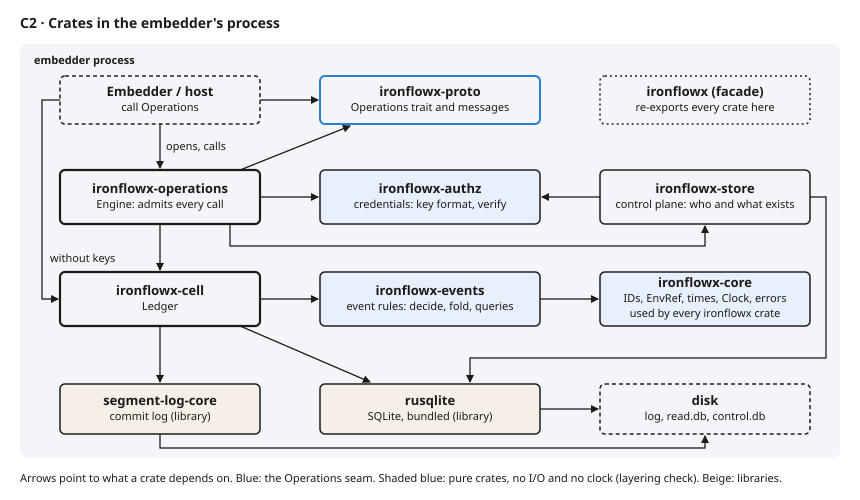
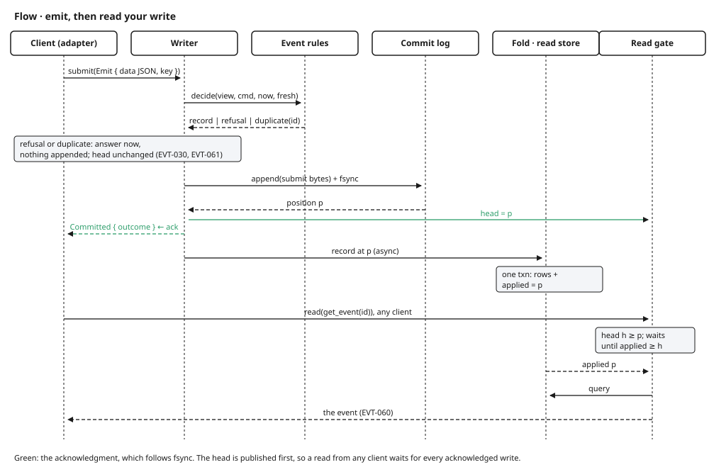

# foundation

An experimental MIT-licensed rewrite of the Ironflow engine. Not the shipping product; Ironflow 1.x is under the Ironflow License.

Foundation crates are 0.x with no semver-stability promise.

## Purpose

Every part of the engine writes through one commit path. Foundation is that path, proven on its own: the crates any Ironflow X product links to commit one environment's events durably, in order, and read them back.

## What 0.1 is

Released as `0.1.0`: one environment's ledger, linked into your process.

- Open it in a directory, and reopen it after a crash with nothing acknowledged lost.
- Emit an event, or a batch of up to 100, with data, metadata, a version and an idempotency key.
- Repeat a key and get the original event's ID back, with nothing new stored.
- Read an event by ID, or list events newest first, as soon as any emit returns.

## Architecture

The ledger is linked, not run: an embedder opens it in a directory. Event rules and core are pure; only the ledger touches disk, the clock and randomness.



A write is acknowledged once its record is fsynced, and a read sees every write acknowledged before it arrived, whoever made it:



More diagrams (modules and seams, crash recovery) and the details are in [`docs/architecture.md`](https://github.com/ironflowx/foundation/blob/main/docs/architecture.md); the decisions behind them are in [`docs/decisions.md`](https://github.com/ironflowx/foundation/blob/main/docs/decisions.md).

| Crate | Contents |
| --- | --- |
| ironflowx-core | IDs, the environment reference, stored and event-clock time, the clock trait, error kinds |
| ironflowx-events | event rules: what an event is and when an emit is refused |
| ironflowx-proto | the Operations interface and its request and answer types |
| ironflowx-cell | the ledger: one environment's durable commit log and read store, and `LocalOperations` |
| ironflowx | every foundation crate, re-exported |

## Use it

Depend on the facade, with `tokio` for the runtime the ledger runs on:

```toml
[dependencies]
ironflowx = "0.1"
tokio = { version = "1", default-features = false, features = ["rt"] }
```

[`examples/embed`](https://github.com/ironflowx/foundation/blob/main/examples/embed/src/main.rs) opens a ledger, emits an event and reads it back.
