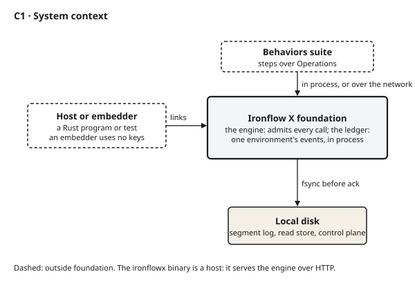
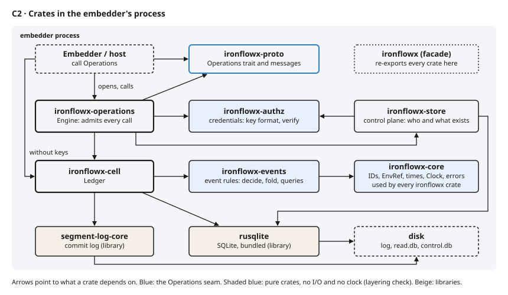
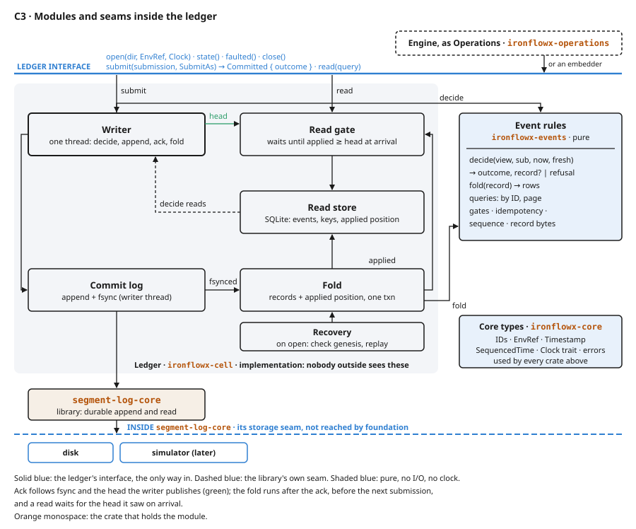
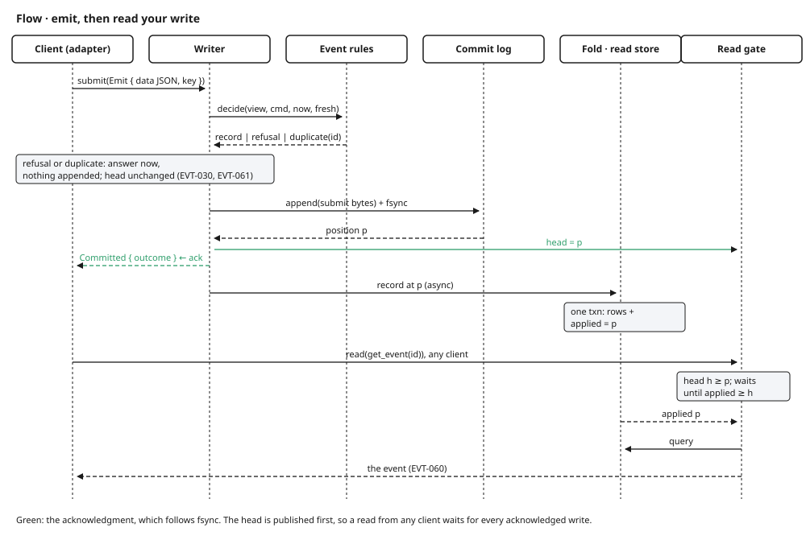

# Architecture

One environment's commit path, as foundation crates linked into an embedder's process.

## C1: Context



The ledger is linked, not run: an embedder opens it in a directory.

## C2: Crates



Event rules, credentials and core are pure. Only the ledger, the control plane and the engine touch disk, the clock and randomness.

## C3: Modules and seams



The ledger's interface is the only way in; everything inside it is implementation.

## Flows



How a write becomes visible to every reader: [Commit and read](#commit-and-read).


The rows behind it: [Open](#open).

## Modules

| Module | Does | Interface | Crate |
|---|---|---|---|
| Ledger | Commits one environment's changes; answers reads that see every acknowledged commit; mints event IDs and stamps event time | `open`, `submit`, `read`, `close`, `LocalOperations`, `HostClock`, `ManualClock` | `ironflowx-cell` |
| Event rules | Decides what an event is and when an emit is refused. Pure | `decide`, `fold`, queries | `ironflowx-events` |
| `Operations` interface | The operations a client calls, with their request and answer types. Hand-written Rust types; 0.3 maps a wire format onto them | `Operations` trait and messages | `ironflowx-proto` |
| Engine | Opens a data directory, bootstrapping it on first open; admits every call (its key parsed, looked up and verified, and its scope checked) before the handler reaches the ledger or the key records | `Engine::open`, `close`, `whoami`, `list_environments`, `emit`, `emit_batch`, `get_event`, `list_events`, `create_key` | `ironflowx-operations` |
| Credentials | The key format and its digest; whether a presented key is valid for an environment at a time, whether a grant holds a scope, and what a new key may hold. Pure | `parse`, `mint`, `verify`, `recheck`, `admit`, `may_create` | `ironflowx-authz` |
| Control plane | Remembers which tenants, projects, environments and keys exist, in `control.db` | `ControlPlane::open`, `bootstrap_state`, `ensure_bootstrap`, `mark_ledger_created`, `lookup_key`, `insert_key`, `environment` | `ironflowx-store` |
| Core types | Validated IDs, `EnvRef`, `Emitter`, `SubmitAs`, `Scope`, `Address`, `Secret`, `Timestamp`, `SequencedTime`, the `Clock` trait, errors | Types | `ironflowx-core` |
| Facade | Re-exports the crates above as modules; the one crate an embedder depends on | Re-exports | `ironflowx` |

`LocalOperations` implements `Operations` over one `Ledger`. It maps each request to a submission and each outcome to an answer and holds no rule: every check, default and limit is in event rules. Tests and embedders use the same adapter. `LocalOperations::new` attributes every submission as `embedder:local-operations` until the engine replaces it (D36); the engine runs its event operations through `LocalOperations::submitting_as`, passing its verified grant's `submit_as()`, so an event emitted with a key records `key:<key-id>`. It answers `create_key` `Unauthenticated`: keys need the engine.

| Type | Is |
|---|---|
| `Timestamp` | A UTC instant in whole milliseconds since the Unix epoch. Private fields; `from_millis` and `as_millis` (`i64`) are the only conversions (D18) |
| `SequencedTime` | A reading of the event clock. Its one constructor is `#[doc(hidden)]`, and a lint allows it only in `ironflowx-cell` (D17); it compares with itself, never with `Timestamp` or `std::time` |
| `Clock` | A trait in core: `fn now(&self) -> Timestamp`. Core declares it and never calls it |
| `EnvRef` | `{ id: EnvironmentId, token: IncarnationToken }`. Text form `<uuid>.<32 hex digits>` via `Display` and `FromStr`, so an embedder can store it. Only the canonical spelling parses: a lowercase, hyphenated UUIDv7 and 32 lowercase hex digits; `EnvironmentId`, `EventId`, `TenantId`, `ProjectId`, `KeyId` and `IncarnationToken` parse the same way |
| `Emitter` | Who emitted an event, as read back: text `key:<key-id>` or `embedder:<name>` via `Display` and `FromStr`. Read-only: nothing converts it into a `SubmitAs` (D36) |
| `SubmitAs` | Who a submission is attributed to, as written: `SubmitAs::embedder(name)`, where the name is 1–128 bytes with no control (Cc), format (Cf) or line or paragraph separator (Zl, Zp) character, so what a reader sees is what was stored, or `SubmitAs::key(KeyId)`, which a lint confines to the credentials crate (D36). Every event of a submission carries its one emitter |
| `Scope` | What a key may do: `read`, `write`, `admin`, text forms of the same names. A key holds a set; none implies another |
| `Address` | Where an environment is, by name: `project/environment` while the single tenant is hidden. Derived from names, never stored, and never parsed into an ID: no `FromStr` (TEN-8) |
| `Secret` | A whole key's text. Implements none of `Debug`, `Display`, `Serialize` and `Clone`; `expose()` is its only read; zeroed on drop (TEN-3) |
| `KeyDigest` | SHA-256 of a key's whole text, in `ironflowx-authz`. Private bytes, no `PartialEq`, `AsRef` or `Deref`; `ct_eq` is its only comparison; `to_stored` and `from_stored`, its storage codec, are confined to `ironflowx-store` by a lint (TEN-4) |
| `KeyRecord` | What credentials need about a stored key: `{ id, env: EnvRef, scopes, digest, expires_at }`, `env` being the environment ID and token current when the key was made |
| `Grant` | What a verified key may do: its key ID, scopes, `EnvRef` and expiry, and `submit_as()`, the key's attribution, the only `SubmitAs::key` call, which clippy confines to the engine (D36). Only `verify` and `recheck` make one; never stored |
| `Authorized` | Proof of admission, `{ grant }`, its field private to the engine's admission module: the engine's key operations take one (TEN-1) |

## Seams

| Seam | Adapters | In 0.1 |
|---|---|---|
| `Operations` | `LocalOperations` over one ledger · a remote client over the network | `LocalOperations`; the remote client arrives with the server in 0.3 |
| `Clock` | `HostClock` · `ManualClock`, which a test sets and steps, backwards too | Both, in `ironflowx-cell`. The behaviors and the crash test use `ManualClock` |
| Control plane | SQLite · a shared database for clusters | SQLite only: hypothetical, so no trait |
| Ledger, event rules, credentials | One adapter each | Module interfaces, not seams |

The segment log has a storage seam of its own, private to `segment-log-core`; 0.1 does not reach it.

## Interfaces

Shapes, abridged. Each crate's full public API is its snapshot in [`public-api/`](../public-api/), which CI checks (D21).

```rust
// ironflowx-proto: the 0.1 subset. No dyn use in 0.1; adapters are generic.
trait Operations: Send + Sync {
    fn emit(&self, cx: &Call, req: EmitRequest) -> impl Future<Output = Result<EmitResponse, OpError>> + Send;
    fn emit_batch(&self, cx: &Call, req: EmitBatchRequest) -> impl Future<Output = Result<EmitBatchResponse, OpError>> + Send;
    fn get_event(&self, cx: &Call, req: GetEventRequest) -> impl Future<Output = Result<Event, OpError>> + Send;
    fn list_events(&self, cx: &Call, req: ListEventsRequest) -> impl Future<Output = Result<EventPage, OpError>> + Send;
    fn create_key(&self, cx: &Call, req: CreateKeyRequest) -> impl Future<Output = Result<CreatedKey, OpError>> + Send;
}
enum Operation { Emit, EmitBatch, GetEvent, ListEvents, Whoami, ListEnvironments, CreateKey }   // each new one joins
const fn required_scope(op: Operation) -> Option<Scope>;   // an exhaustive match (D37); None: any valid key
// EmitRequest      { name: String, data: Option<Vec<u8>> /* one JSON value (D22); None stores null */,
//                    metadata: Option<Vec<u8>> /* one JSON object */, version: Option<i64> /* None stores 1 */,
//                    idempotency_key: Option<String> /* None: no key */ }
// EmitResponse     { event_id: EventId, duplicate: bool }
// EmitBatchRequest { items: Vec<EmitRequest> }
// EmitBatchResponse{ items: Vec<Result<EmitResponse, OpError>> }  // one per input, in input order
// GetEventRequest  { event_id: String }                            // an ID that does not parse is NotFound
// Event            { event_id, name, data: Vec<u8> /* the bytes as sent */, metadata: Option<Vec<u8>>, version: i64,
//                    idempotency_key: Option<String>, time: Timestamp, emitted_by: Emitter }
// ListEventsRequest{ limit: Option<NonZeroU32> /* None 20, above 200 clamps to 200 */, cursor: Option<String> }
// EventPage        { events: Vec<Event> /* newest first */, next: Option<String> /* None on the last page */ }
// Call             Call::anonymous() | Call::with_key(Secret)   // the key as presented (D45); not Clone
// OpError          { kind: ErrorKind, message: String, hint: Option<String> }   // see Errors
// Whoami           { key_id: KeyId, scopes: BTreeSet<Scope>, environment: Address, expires_at: Option<Timestamp> }
// Environment      { env: EnvRef, name, address: Address, project_id: ProjectId, created_at: Timestamp }
// WhoamiRequest {} · ListEnvironmentsRequest {}   // no request takes an environment (LED-7)
// CreateKeyRequest { scopes: BTreeSet<Scope> /* empty: {read} */, expires_at: Option<Timestamp>, label: Option<String> }
// CreatedKey       { key: Secret /* returned once */, info: KeyInfo }   // no Clone or PartialEq; Debug prints no key
// KeyInfo          { key_id, label, scopes, origin: Created, created_by: Option<KeyId>, created_at,
//                    expires_at, status: Active }   // other origins and statuses join when keys are listed

// ironflowx-operations (tokio). These are the engine's own methods until the engine implements
// the Operations trait. Each admits the call first, with no cache.
impl Engine {
    async fn open(root: &Path, clock: impl Clock + Clone + Send + Sync + 'static) -> Result<Opened, EngineError>;
    async fn close(self);
    async fn whoami(&self, cx: &Call, req: WhoamiRequest) -> Result<Whoami, OpError>;
    async fn list_environments(&self, cx: &Call, req: ListEnvironmentsRequest) -> Result<Vec<Environment>, OpError>;
    // As Operations; each submission is attributed to the calling key, from its grant (TEN-6).
    async fn emit(&self, cx: &Call, req: EmitRequest) -> Result<EmitResponse, OpError>;
    async fn emit_batch(&self, cx: &Call, req: EmitBatchRequest) -> Result<EmitBatchResponse, OpError>;
    async fn get_event(&self, cx: &Call, req: GetEventRequest) -> Result<Event, OpError>;
    async fn list_events(&self, cx: &Call, req: ListEventsRequest) -> Result<EventPage, OpError>;
    async fn create_key(&self, cx: &Call, req: CreateKeyRequest) -> Result<CreatedKey, OpError>;
}
// Opened      { engine: Engine, minted: Option<Secret> }   // the bootstrap key, returned by the bootstrapping open only
// EngineError Locked | Ledger(OpenError) | Store(StoreError) | Io(io::Error)

// ironflowx-authz: pure, depends only on core. The engine passes in the random secret.
fn parse(raw: &Secret) -> Result<KeyParts, Malformed>;   // KeyParts { id: KeyId, digest: KeyDigest }
fn mint(id: KeyId, secret: [u8; 32]) -> (Secret, KeyDigest);
fn verify(parts: &KeyParts, record: Option<&KeyRecord>, env: &EnvRef, now: Timestamp) -> Result<Grant, Refused>;
fn recheck(record: &KeyRecord, env: &EnvRef, now: Timestamp) -> Result<Grant, Refused>;   // verify, without the secret
fn admit(grant: &Grant, required: Option<Scope>) -> Result<(), MissingScope>;   // MissingScope::scope() names it
fn may_create(creator: &Grant, scopes: &BTreeSet<Scope>, expires_at: Option<Timestamp>, label: Option<&str>,
              now: Timestamp) -> Result<(), CreateRefusal>;

// ironflowx-store: blocking; the engine calls it under spawn_blocking. A write takes SQLite's
// write lock (BEGIN IMMEDIATE) first, then reads now from the clock it is given.
impl ControlPlane {
    fn open(path: &Path) -> Result<ControlPlane, StoreError>;               // creates the schema; refuses another format
    fn bootstrap_state(path: &Path) -> Result<BootstrapState, StoreError>;  // read-only; creates nothing
    // BootstrapState: NoFile | Unbootstrapped | Unmarked { env: EnvRef } | Marked { env: EnvRef }
    fn ensure_bootstrap(&self, b: &Bootstrap, clock: &dyn Clock) -> Result<(), StoreError>; // one transaction
    // Bootstrap { env: EnvRef, tenant: TenantId, project: ProjectId, key: KeyParts }   // the engine draws each
    fn mark_ledger_created(&self, env: &EnvRef, clock: &dyn Clock) -> Result<(), StoreError>;
    fn lookup_key(&self, id: KeyId, env: &EnvRef) -> Result<Option<KeyRecord>, StoreError>; // admission's one read
    // One transaction: reads the creator's record again and checks it (recheck), then the request (may_create)
    fn insert_key(&self, env: &EnvRef, new: NewKey, creator: KeyId, clock: &dyn Clock) -> Result<KeyRow, InsertError>;
    // NewKey { id, digest, scopes, label, expires_at } · KeyRow { seq, record: KeyRecord, label, created_at }
    // InsertError Creator | Refused(CreateRefusal) | Store(StoreError)
    fn environment(&self, env: &EnvRef) -> Result<EnvironmentRecord, StoreError>;
}

// ironflowx-cell (tokio)
impl Ledger {
    // open, read and close panic outside a tokio runtime
    async fn open(dir: &Path, env: EnvRef, clock: impl Clock + Send + 'static) -> Result<Ledger, OpenError>;
    async fn submit(&self, sub: Submission, by: SubmitAs) -> Result<Committed, SubmitError>;   // trusts `by` (D36)
    // q is a query from event rules (get_event, list_events) over the read store; a q that panics fails the ledger
    async fn read<R: Send + 'static>(&self, q: impl FnOnce(&ReadStore) -> Result<R, Error<StoreError>> + Send + 'static)
        -> Result<R, ReadError>;
    fn env(&self) -> EnvRef;
    async fn close(self);   // drains in-flight submits and the fold, then releases the directory lock
}
fn new_env_ref() -> EnvRef;   // a fresh UUIDv7 ID and a 128-bit token from the OS random source
// Committed   { outcome: Vec<ItemOutcome> }   // one per item, in input order
// ItemOutcome New(EventId) | Duplicate(EventId) | Refused(Refusal)   // Refused only inside a batch
// SubmitError Refused(Refusal) | Unknown | Unavailable              // Refused: a single emit, or a whole batch
// ReadError   Refused(Refusal) | Unavailable                        // a read-store failure fails the ledger

// ironflowx-events: pure. `fresh` yields one event ID per new event, minted by the writer.
fn decide<V: EventsView>(view: &V, sub: &Submission, now: SequencedTime,
          fresh: &mut impl Iterator<Item = EventId>) -> Result<Decision, Error<V::Error>>;
fn fold<T: EventTables>(tx: &mut T, record: &Record, emitted_by: &Emitter) -> Result<(), T::Error>;
// Error<E> Refused(Refusal) | Store(E)   // E: the view's own read error
```

## Event rules

`decide` runs in this order, and every step runs before the idempotency lookup (D5):

1. **Batch count:** more than 100 items refuses the whole batch.
2. **Item rules**, below, per item. A breach refuses the emit, or that batch item, as `Invalid`.
3. **Batch bytes:** the data and metadata of the items that passed step 2, as sent, total at most 4 MiB; else the whole batch is refused.
4. **Idempotency lookup**, in input order. A key seen earlier in the same batch counts (EVT-022).
5. **IDs:** one drawn from `fresh` per new event.

| Field | Rule | Scenarios |
|---|---|---|
| Name | 1–256 bytes of UTF-8 (bytes, not characters) | EVT-010, EVT-011, EVT-012 |
| Name | Segments split on `.`; none empty. No Unicode whitespace (`char::is_whitespace`), no control character (`char::is_control`) | EVT-011, EVT-012 |
| Name | Owned, so refused, in exact case: `ironflowx`, `ironflowx.…`, `$system`, `$system.…` | EVT-012, EVT-013 |
| Data | Absent stores `null`. Otherwise one JSON value of at most 524,288 bytes as sent, stored and returned as those bytes | EVT-003, EVT-004, EVT-017, EVT-039 |
| Data, metadata | Valid UTF-8. Nested at most 127 deep; no number outside `f64` range; no key repeated in one object at any depth, comparing keys after unescaping; no NUL in any key or string after unescaping; no unpaired surrogate escape | EVT-016, EVT-039 |
| Data | A top-level object key `$redacted`, whatever its value, is refused; nested ones are accepted | EVT-014, EVT-015 |
| Metadata | Absent, or a JSON object of at most 65,536 bytes as sent | EVT-016, EVT-038 |
| Version | Absent stores 1; otherwise 1 to 2,147,483,647 | EVT-002, EVT-008, EVT-009 |
| Idempotency key | Absent means no key; otherwise 1–256 bytes, no NUL. One key per environment, across names, for as long as its event exists | EVT-030–037 |
| Batch | An empty batch answers with no results | EVT-023 |

If a build turns on `serde_json`'s `arbitrary_precision` feature, which Cargo's feature unification can do from any crate in the embedder's graph, an object whose first key is `$serde_json::private::Number` is read as a number and so may be refused. A default build reads that key like any other. CI runs the event-rule tests in both builds.

A list query, not `decide`, checks the cursor: a token that does not decode, or names another incarnation, is `Invalid` (EVT-045, EVT-055). A cursor encodes the incarnation token and the last event sequence returned, and stays valid across reopen. A page lists the events older than the cursor's sequence, whether or not an event has that sequence, so a cursor past every sequence lists from the newest. It is an encoding, not a signature: 0.1 does not detect a forged one.

## Keys

| Part | Rule |
|---|---|
| Text | `ixk_` + the key ID's 36-character text form + `_` + 43 base64url characters without padding (256 random bits): always 84 characters, parsed by position, since the secret may hold `_` and `-` (D46). Anything else is malformed, including an uppercase or non-v7 key ID and a non-canonical last character |
| Key ID | The key's UUIDv7. Not a secret |
| Stored | The `KeyDigest` of the whole key text, and the environment ID and token current when the key was made. The secret is never stored, logged or returned after creation |
| Valid | Parses; a record exists for the engine's environment ID and token; digests match, compared in constant time; not expired: `now < expires_at` when an expiry is set, by the ledger's clock |
| Scopes | A non-empty set of `read`, `write`, `admin`, none implying another (D27). The bootstrap key holds all three |
| Created | By a key holding `admin`. Scopes default to `{read}` when none are asked for, and must be a subset of the creator's. The expiry must be after now and no later than the creator's; no expiry only when the creator has none (D28). A label is 0–128 bytes of UTF-8 with no control character (Unicode Cc). All checked inside the transaction, with now read after the write lock, the creator's record read again there |

**Admission.** Every call runs, in order: no key, or an empty one → `Unauthenticated`; `parse`; `lookup_key(id, env)`, a read-only lookup with no cache (D45); `verify` at the clock's now; `admit` against `required_scope(op)` (D37). Only then does the handler run, and it reaches the ledger only through `ledger(&Authorized)` and the key records only through `keys(&Authorized)`. Admission writes nothing.

| Operation | Scope |
|---|---|
| `emit`, `emit_batch` | `write` |
| `get_event`, `list_events`, `list_environments` | `read` |
| `whoami` | any valid key |
| `create_key` | `admin` |

## Errors

The kind is contract. Four messages are contract too: `event name is required`, `event data exceeds maximum size`, `batch size {n} exceeds maximum of 100` and `event not found`. Other messages are not.

| Kind | When | Retry |
|---|---|---|
| `Invalid` | A rule refused the request, or one batch item; or `create_key` with more scopes than the creator, an expiry not after now or later than the creator's, or a bad label | No: the same request is refused the same way |
| `NotFound` | No event has that ID, or the ID does not parse | No |
| `Unknown` | The append's outcome is unknown; the ledger is now `Unavailable` | After reopen. With a key, the retry returns the original event if it landed. Without one it may store a second event |
| `Unavailable` | The ledger failed (append, fold, read store, or a `read` query that panicked) and refuses every call until it is reopened. Reads waiting at the gate end with it | After reopen |
| `Unavailable` | A control-plane read or write failed during admission or a handler. The call fails closed and changes nothing; the engine stays open (D44). A `create_key` whose answer was lost may have committed | Yes, at once |
| `Unauthenticated` | No key, or an empty one: `authentication required` | No |
| `Unauthenticated` | A malformed key: `invalid API key`, with the key format in `hint` | No |
| `Unauthenticated` | An unknown key ID, a wrong secret, an expired key, or a key of another environment or incarnation: `invalid API key`, the same answer for each, with no hint (D29, D30). Also a `create_key` whose creator expired before its key was stored | No |
| `PermissionDenied` | The key lacks the operation's scope: `missing scope: <scope>`, with `hint` saying to create or use a key with that scope (D31) | No |

`ErrorKind::retryable()` is true when the same request, unchanged, may succeed later: `Unavailable` and `Unknown`. `OpError::hint` says when, or what to do. The three `Unauthenticated` messages and the `PermissionDenied` message are contract.

## Commit and read

1. The writer processes one submission at a time (D15). Up to 16 more can wait in its queue. A submit waits asynchronously for a slot. Cancelling before admission leaves no job for the writer. Cancelling after admission, or timing out, only drops the answer: the write can still commit. Its outcome is unknown to the caller, so retry with the same idempotency key; no reopen is needed. For each submission it reads the event clock and calls `decide` against the read store, drawing IDs from a UUIDv7 generator.
2. Nothing to append (all refused, or all duplicates): it answers at once.
3. Otherwise it appends one record holding every new event and waits for the log's fsync, off the async threads. Each new event takes the next event sequence, from 1, in input order.
4. It publishes the new committed head to the read gate, then acknowledges. Then it folds the record, before it takes the next submission, so the read store holds every earlier record when `decide` runs.
5. A read snapshots the committed head when it arrives and waits until the applied position reaches it. So it sees every write acknowledged before it arrived, whoever made it.

If the writer panics, submissions still queued or being decided return `Unavailable`. A submission whose append began and lost its reply returns `Unknown`.

The committed head and the applied position are exclusive positions: one past the last record, as the log's watermark is.

## Open

`open` syncs the parent of each directory it creates. It takes the ledger lock before opening the log and then the read store.

| Directory state | Result |
|---|---|
| Empty or missing | Creates the log and appends the genesis record (format version, environment ID, incarnation token) at position 0, then creates `read.db` and folds it; ready |
| Log, genesis matches the `EnvRef` and format | Checks that the newest stored event ID and sequence match the last applied record, rebuilding on mismatch. Replays one record at a time from the applied position |
| Log, genesis differs in environment ID or token | `OpenError::WrongIncarnation` |
| Log, genesis differs in format version, or the log's own format is unsupported | `OpenError::Format` |
| `read.db` missing, without `meta`, unreadable, its tables damaged, or `meta` disagrees with the genesis record | Deletes `read.db` and its `-wal` and `-shm` files, rebuilds from position 0 |
| Empty log and an existing `read.db` whose applied position cannot be read | `OpenError::Io` preserves the store for inspection |
| Empty log and a readable `read.db` with a positive applied position, for any incarnation | `OpenError::Corrupt` before writing genesis or replacing the store |
| The log ends in a torn last frame, after a crash | The log truncates it; opens with the records before it |
| `read.db` names this environment and its applied position is beyond the log's watermark | `OpenError::Corrupt`, before a genesis record is written: the fold follows fsync, so the log lost durable records: an older copy of the log restored, or, after a crash, a bad last frame the log truncated as a torn tail (a crash writes no close frame, so nothing after it shows it was acknowledged). Without `read.db`, that last record is lost unreported |
| A replayed record carries another token or format, or does not decode | `OpenError::Corrupt` |
| The record at position 0 is not a genesis record | `OpenError::Corrupt` |
| The log reports corruption (including a bad frame in its newest segment with a later record or a close frame after it), a gap or a foreign segment | `OpenError::Corrupt` |
| Another process or `Ledger` holds the directory | `OpenError::Locked`, including on sealed logs. The OS releases the ledger lock when the process exits |
| Any other I/O failure | `OpenError::Io` |

The genesis record is the directory's identity; `read.db` is derived state and never trusted over it. The log binds every segment to one log ID, so a segment from another log does not open.

Dropping a `Ledger` without `close` stops the writer after the submission in hand; queued submits, never decided, end `Unavailable`. The drop joins the writer, so it blocks, and the lock is released before it returns; async code calls `close`.

### When open answers `Corrupt`

`Corrupt` is for a person to resolve; the ledger never repairs itself. It comes from one of three places, and all look the same to the embedder:

- **The log refused.** The segment log found damage it will not truncate on its own.
- **The ledger refused.** The log opened, but `read.db` names this environment and has folded records the log no longer holds, or the log is empty and any `read.db` records progress; then `read.db` is the last copy of those events. The fold runs only after fsync, so the log lost acknowledged events: after a crash, a bad last frame the log truncated as a torn tail (a clean close writes a close frame that proves the records before it; a crash writes none, so the log cannot tell damage from a torn write), an older copy of the log restored, a deleted segment, or a lossy repair (below).
- **The ledger refused a record.** The log is sound, but a record in it is not one this ledger wrote: another incarnation's token or format, a record that does not decode, or no genesis record at position 0.

Steps, with the embedder stopped:

1. **Copy the whole directory** before changing anything.
2. **Ask the log:** `segment-log-server repair verify` on `<dir>/log`. The `repair` subcommands, flags and exit codes are in the segment log's [Operator repair](https://github.com/ironflowx/segment-log/blob/v0.2.0/docs/architecture/api.md#operator-repair) section, the only source for them.
3. **If verify reports damage**, the log refused. Only damage in the newest segment is repairable: run `repair truncate`, a dry run that prints the plan, then apply it.
   - **Lossless plan:** reopen the ledger. It replays and opens.
   - **Lossy plan:** acknowledged records are dropped and the tool needs `--drop-acknowledged`, which leaves the log sealed. Go to step 4, then read the note on a sealed log.
     The segment log's repair class F ([segment-log ADR 0068](https://github.com/ironflowx/segment-log/blob/v0.2.0/docs/decisions/0068-open-refuses-damage-with-acknowledged-groups-after-it.md)) is a bad frame in the newest unsealed segment with a later record or a close frame after it. Its plan is always lossy: apply it with `--drop-acknowledged`. The tool refuses it (exit code 3) when the damage is in the second-newest segment, when the second-newest segment lacks its closing run, or when the seal run would reach the last acknowledged record after the cut and that record is a group frame; then restore from a backup. When the proof after the cut is a close frame, which every clean `close` writes, the plan copies it past the seal run and can apply. The segment log's section above is the authority on these cases.
   - **Other damage** (an older segment, the headers) is not repairable in 0.1: restore the directory from a backup.
4. **If verify is clean**, or after a lossy repair, the ledger refused. Prefer restoring the directory from a backup at least as new as the last acknowledged emit. To accept the loss instead (if the log was empty, the step 1 copy of `read.db` is the only copy of those events: keep it), delete `<dir>/read.db` and its `-wal` and `-shm` files and reopen: the ledger rebuilds the read store from the log as it now is. This deletion is the one step that accepts lost events.
5. **If it still answers `Corrupt`** after the deletion, the ledger refused a record: rebuilding cannot get past it. Restore the directory from a backup taken before that record was written. The step 1 copy holds the same record and will not open; keep it for inspection.

After accepting a loss, the lost events are gone for good, and so are their idempotency keys: a client's keyed retry stores a new event instead of returning the original. New events reuse the lost event sequences, so a cursor issued before the loss can page into events stored after it.

A sealed log, after a lossy repair, opens and reads until the first emit that appends. That append fails the ledger: the emit answers `Unavailable`, and so does every later call, reads included, until it is reopened (D19). An emit that appends nothing, a duplicate or a refusal, is answered as usual. Serve a sealed ledger read-only: do not emit to it. 0.1 cannot unseal it. To take writes again, create a new environment (`new_env_ref`) in a new directory; moving events into it is outside 0.1.

`WrongIncarnation` and `Format` are not damage: the `EnvRef` or the build does not match the directory. Open it with the `EnvRef` it was created with, or with a build that reads its format.

## Engine open

`Engine::open(root, clock)` creates `root` if missing, takes the OS lock on `<root>/engine.lock` (another holder: `Locked`; the file is never deleted, so every contender locks the same one), reads the bootstrap state of `control.db` without creating it, and deletes a leftover `ledgers/.staging/`, which never holds anything acknowledged. Then:

| Finds | Does | `Opened.minted` |
|---|---|---|
| No `control.db`, or one never bootstrapped | A bootstrapping open: `new_env_ref()`; `ensure_bootstrap`, one transaction creating the tenant, project and environment named `default`, with fresh UUIDv7s, and the minted bootstrap key holding all three scopes; build the ledger in `ledgers/.staging/`, close it, rename it to `ledgers/<environment-id>/` (D40) and open it there; then `mark_ledger_created`, the last fallible step, so no failure after it can lose the secret | The bootstrap key's secret, returned this once |
| A marked bootstrap | A later open: the environment's ledger, with 0.1's open | None |
| An unmarked bootstrap: an earlier open died before its mark | Refused with an `Io` error naming the unfinished bootstrap, changing nothing; finishing it is not built yet | |

## What is stored

An engine's data directory, `<root>`:

| Where | Holds |
|---|---|
| `<root>/engine.lock` | The engine's lock file; never deleted |
| `<root>/control.db` (SQLite, WAL, `synchronous=FULL`, `fullfsync`) | `tenants` (id, name, created_at) · `projects` (id, tenant_id, name, created_at) · `environments` (id, project_id, name, token, created_at, ledger_created_at) · `keys` (seq, id, environment_id, environment_token, scopes, digest, origin, created_by, label, expires_at, created_at) · `meta` (format version, 1). Times are `Timestamp`'s `i64` milliseconds (D18); the digest is `KeyDigest::to_stored()`; no last-used time (D38) |
| `<root>/ledgers/<environment-id>/` | The environment's ledger, laid out as below |
| `<root>/ledgers/.staging/` | A ledger being built; deleted by any open that finds it |

A ledger's directory, `<dir>`:

| Where | Holds |
|---|---|
| `<dir>/ledger.lock` | File used for exclusive ownership of the ledger directory, including during read-store rebuild |
| `<dir>/log/` (segment log) | Position 0: the genesis record, with the ledger's own format version, 2 (D39; a format-1 directory from 0.1 answers `Format`). Then one record per submit that appends: format version, incarnation token, emitter, event-clock time, and for each new event its sequence, ID, name, version, key, metadata and data. Binary and length-prefixed; data and metadata are the bytes as sent |
| `<dir>/read.db` (SQLite) | `events` keyed by sequence, unique by ID, each with its `emitted_by` · `idempotency` key → event ID · `meta`: applied position, environment ID, incarnation token, format version |

A record's worst case is 100 × (about 600 bytes of fixed fields and lengths) + 4 MiB of data and metadata, under 4.1 MiB.

## Depends on

| Crate | Version | Used | Relied on |
|---|---|---|---|
| `segment-log-core` | Pinned exactly (D16), from crates.io (MIT) | `SegmentLog::open`, `append` → `Pending::wait`, `read(from, max)`, `watermark`, `stream_head` | See below |
| `rusqlite` | A caret range (0.43.x), `bundled` (D26) | Read store; the control plane | One transaction per folded record; one per control-plane change |
| `serde_json` | Pinned exactly (D26); the 127 depth limit is checked against it | Event rules | D12 |
| `serde_core` | A caret range | Event rules' JSON visitor | D12 |
| `uuid` | A caret range; `v7` in `ironflowx-cell` and `ironflowx-operations` only | Event, environment, tenant, project and key IDs | |
| `getrandom` | A caret range (D26) | `new_env_ref`; a key's secret | OS random source |
| `sha2`, `subtle`, `base64` | Caret ranges | Credentials: the key digest, its constant-time comparison, the key text | Pure: `ci/purity/ironflowx-authz.allow` names everything they pull in, `libc` included (only `cpufeatures`' CPU detection on AArch64 uses it) |
| `zeroize` | A caret range | `Secret` is zeroed on drop | In `ironflowx-core.allow` |
| `tokio` | A caret range (D26) | `spawn_blocking` for open, reads and close; the read gate; the answer to a submission | |

How the ledger uses the log:

- **Options:** `group_byte_cap` 8 MiB (the library's maximum, above the 4.1 MiB worst case), `pending_byte_budget` at least that, `linger` 0, since the writer sends one record at a time.
- **Records:** one stream, `events`; the genesis record expects `ExpectedRevision::Empty`, each later one `At(last revision)`. No log key: the ledger keeps its own idempotency.
- **Errors:** `CommitError::Indeterminate` is `Unknown`. `CommitError::Poisoned` and `AppendError::Poisoned` are `Unavailable`. Every other append or commit error (`Full`, `TooLarge`, `Invalid`, `Sealed`, `WrongRevision`, `KeyConflict`, `PartialRetry`, `Exhausted`) cannot happen by construction; if one does, the ledger treats it as a fault: `Unavailable` until reopened.
- **A sealed log:** nothing in 0.1 seals one; only the log's operator repair tool does. The library opens it without an error and cannot say it is sealed until an append, so `open` succeeds, reads work, and the first append is the fault above, after which reads answer `Unavailable` too (D19).
- **Names:** the log's `Record`, `Position` and `Committed` types stay private to `ironflowx-cell`. This repo calls them the log record and the log offset; the ledger's own terms are in [`GLOSSARY.md`](../GLOSSARY.md).
- **Durability:** `wait` returns after the record's `sync_data`, which is a full flush on Linux and macOS. 0.1 claims crash durability on both. Power-loss durability is unclaimed until the simulator proves it.
- **Close:** `close`, and dropping a `Ledger`, drop the log cleanly, so it writes a close frame after the last record (segment-log format version 4, [ADR 0071](https://github.com/ironflowx/segment-log/blob/v0.2.0/docs/decisions/0071-a-clean-drop-writes-a-close-frame.md)). The upgrade is one-way: once a build on `segment-log-core` 0.2 has opened a directory, a build on 0.1 answers `Format` for it.

The decisions behind this design: [`decisions.md`](decisions.md).
