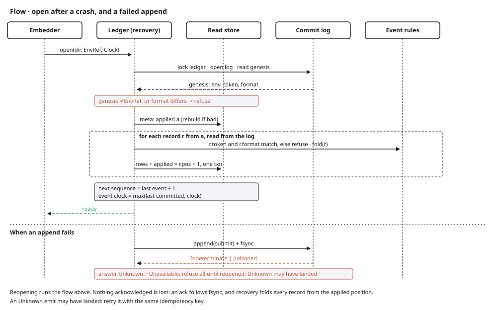

# Architecture

One environment's commit path and the engine in front of it, as foundation crates linked into a host's or an embedder's process, with the HTTP door a host serves the engine through and the proto client that calls it. The first host, the `ironflowx` binary, and its CLI are built in [`ironflowx/ironflow`](https://github.com/ironflowx/ironflow) from these crates, not here (D85).

## C1: Context


The engine is a library: a host opens it on a data directory, and every call to it carries a key. An embedder that needs no keys opens a ledger in a directory instead.

A host that serves the engine through the HTTP door, as `ironflowx serve` does, is a process. Outside it:

- a client calls the engine over HTTP, by Connect, gRPC or gRPC-Web, with a key, and reaches it no other way;
- an orchestrator watches `/health` and `/ready`, with no key;
- the operator takes the admin key from the host.

## C2: Crates


Event rules, credentials and core are pure. Only the ledger, the control plane, the engine and the host touch disk, the clock and randomness.

Around the engine, not in the diagram, each depending on what its line names:

- `ironflowx-proto`, with a wire feature on: the proto, its generated messages and their mapping, and the proto client. It links `connectrpc` and `buffa`, and at build time `connectrpc-build` and `protox`. With none on, it links only `ironflowx-core`.
- `ironflowx-doors`: the HTTP door, on `ironflowx-proto` and `ironflowx-core`, and no engine crate (SRV-1). Published from 0.4 (D85).
- `ironflowx-codegen`: the generator, which a CLI's `build.rs` calls; on no crate of ours. Published from 0.4 (D85).

The `ironflowx` facade lets an embedder opt in to the proto client. The facade's `client` feature enables `ironflowx-proto/client`. Its `client-tls` feature enables `client` and `ironflowx-proto/client-tls`. Both are off by default, so a standalone in-process embedder builds no HTTP stack.

## C3: Modules and seams


Inside the ledger: its interface is the only way in, and everything behind it is implementation. The engine in front of it, with its credentials and control plane, is in [Modules](#modules), a call's way through them in [Keys](#keys) ("Admission").

In front of the engine, in a host, a call goes through:

1. the host's accept loop, which reads the request;
2. the HTTP door, which decodes it, takes its key from `Authorization`, and converts it to an `Operations` request;
3. the slot, which answers for the engine until it is open;
4. the engine, through `Operations`; the answer, or the error, goes back the same way.

`Operations` is a real seam: the engine in process and the proto client over Connect are its two adapters.

## Flows


How a write becomes visible to every reader: [Commit and read](#commit-and-read).



The rows behind it: [Open](#open); an engine's are in [Engine open](#engine-open).

## Modules


| Module | Does | Interface | Crate |
|---|---|---|---|
| Ledger | Commits one environment's changes; answers reads that see every acknowledged commit; mints event IDs and stamps event time; reports whether it has failed, and signals a ledger fault | `open`, `open_blocking`, `open_existing_blocking`, `submit`, `get_event`, `list_events`, `state`, `faulted`, `close`, `HostClock`, `ManualClock` | `ironflowx-cell` |
| Event rules | Decides what an event is and when an emit is refused; makes and sequences the engine's own events, which it refuses from a client; a refusal may carry a hint. Pure | `decide`, `check_emit`, `engine_event`, `sequence`, `fold`, queries | `ironflowx-events` |
| `Operations` interface | The operations a client calls, with their request and answer types. Hand-written Rust types, which the wire maps onto (D53) | `Operations` trait and messages | `ironflowx-proto` |
| Proto | Defines an operation once, on the wire (D49) | `proto/ironflowx/v1/*.proto`: services, messages, the method options `cli`, `summary` and `example`, the field option `json_text` | `ironflowx-proto` (the `.proto` files; compiled, `wire::FILE_DESCRIPTOR_SET`) |
| Wire mapping | Converts `Operations` requests and answers to and from wire messages, validating what arrives | `TryFrom` for requests, both ways; `From` for answers sent and `TryFrom` for answers received; `OpError` ↔ `ErrorInfo` ↔ the Connect error | `ironflowx-proto` (`wire`, `server`) |
| Proto client | Calls `Operations` over Connect, sending each `Call`'s key | `Client::new(url)`, `with_timeout`, `Operations` | `ironflowx-proto` (`client`; `client-tls` for `https`) |
| HTTP door | Serves `Operations` over Connect, gRPC and gRPC-Web, with `/health` and `/ready`. Holds no rule | `router(slot)`, `Slot`, `Readiness` | `ironflowx-doors` (`http`) |
| Generator | Derives a CLI's commands from the proto at build time, and refuses a proto that does not say enough | `generate(descriptor_set, out_dir)`, from `build.rs` | `ironflowx-codegen` |
| Engine | Reads whether the bootstrap is marked; opens a data directory, bootstrapping it on first open; admits every call (its key parsed, looked up and verified, and its scope checked) before the handler reaches the ledger or the key records; reports its health and a ledger fault to the host; checks an emit without a submit | `is_bootstrapped`, `Engine::open`, `health`, `faulted`, `close`, `Operations`, `recover_admin_key`, `check_emit` | `ironflowx-operations` |
| Credentials | The key format and its digest; whether a presented key is valid for an environment at a time, whether a grant holds a scope, and what a new key may hold. Pure | `parse`, `mint`, `verify`, `recheck`, `verify_seed`, `admit`, `may_create` | `ironflowx-authz` |
| Control plane | Remembers which tenants, projects, environments and keys exist, in `control.db` | `ControlPlane::open`, `bootstrap_state`, `ensure_bootstrap`, `undo_bootstrap`, `mark_ledger_created`, `finish_bootstrap`, `check_seed`, `apply_seed`, `lookup_key`, `record_expiry`, `insert_key`, `insert_recovered`, `revoke_key`, `list_keys`, `environment` | `ironflowx-store` |
| Core types | Validated IDs, `EnvRef`, `Emitter`, `SubmitAs`, `Scope`, `KeyOrigin`, `Address`, `Secret`, `Timestamp`, `SequencedTime`, the `Clock` trait, errors; the size limits of what a caller sends | Types, `limits` | `ironflowx-core` |
| Facade | Gives embedders one dependency on foundation | Re-exports `core`, `proto`, `cell` and `operations`, not the engine's own `store`, `authz` and `events` (D83). `proto::Client` with `client`, also accepting `https` with `client-tls` | `ironflowx` |

`Engine` is the one in-process `Operations`, so `Operations` always means credentialed (D36). For an event operation it maps the request to a submission or a query and the outcome to an answer, and holds no event rule: every check and default is in event rules, and the size limits they check are in `ironflowx_core::limits` (D120). `check_emit` runs event rules' checks of one emit without a submit, so an embedder or executor sizes a payload before it sends it instead of learning a limit from a refusal: an emit that admission lets through is refused by event rules, with the same kind and message, exactly when `check_emit` refuses it, unless event sequences are used up. It reads no key, so it cannot say what admission will answer. It submits as its verified grant's `submit_as()`, so an event emitted with a key records `key:<key-id>`. An embedder that needs no keys calls `Ledger::submit`, `get_event` and `list_events` directly, as `SubmitAs::embedder(name)`; the ledger trusts it.

| Type | Is |
|---|---|
| `Timestamp` | A UTC instant in whole milliseconds since the Unix epoch. Private fields; `from_millis` and `as_millis` (`i64`) are the only conversions (D18) |
| `SequencedTime` | A reading of the event clock. Its one constructor is `#[doc(hidden)]`, and a lint allows it only in `ironflowx-cell` (D17); it compares with itself, never with `Timestamp` or `std::time` |
| `Clock` | A trait in core: `fn now(&self) -> Timestamp`. Core declares it and never calls it. `now` must not panic: it runs on the ledger's writer and under the control plane's lock |
| `EnvRef` | `{ id: EnvironmentId, token: IncarnationToken }`. Text form `<uuid>.<32 hex digits>` via `Display` and `FromStr`, so an embedder can store it. Only the canonical spelling parses: a lowercase, hyphenated UUIDv7 and 32 lowercase hex digits; `EnvironmentId`, `EventId`, `RunId`, `TenantId`, `ProjectId`, `KeyId` and `IncarnationToken` parse the same way |
| `Emitter` | Who emitted an event, as read back: text `key:<key-id>` or `embedder:<name>` via `Display` and `FromStr`. Read-only: nothing converts it into a `SubmitAs` (D36) |
| `SubmitAs` | Who a submission is attributed to, as written: `SubmitAs::embedder(name)`, where the name is 1–128 bytes with no control (Cc), format (Cf) or line or paragraph separator (Zl, Zp) character, so what a reader sees is what was stored, or `SubmitAs::key(KeyId)`, which a lint confines to the credentials crate (D36). Every event of a submission carries its one emitter |
| `Scope` | What a key may do: `read`, `write`, `admin`, `execute`, text forms of the same names. A key holds a set; none implies another (D107) |
| `KeyOrigin` | How a key came to be: `Minted`, `Seed`, `Recovered` or `Created`. In core, since the control plane stores it and the interface lists it, and neither depends on the other |
| `Address` | Where an environment is, by name: `project/environment` while the single tenant is hidden. Derived from names, never stored, and never parsed into an ID: no `FromStr` (TEN-8) |
| `Secret` | A whole key's text. Implements none of `Debug`, `Display`, `Serialize` and `Clone`; `expose()` is its only read; zeroed on drop (TEN-3) |
| `KeyDigest` | SHA-256 of a key's whole text, in `ironflowx-authz`. Private bytes, no `PartialEq`, `AsRef` or `Deref`; `ct_eq` is its only comparison; `to_stored` and `from_stored`, its storage codec, are confined to `ironflowx-store` by a lint (TEN-4) |
| `KeyRecord` | What credentials need about a stored key: `{ id, env: EnvRef, scopes, digest, expires_at, expiry_recorded, revoked_at }`, `env` being the environment ID and token current when the key was made. `expired(now)` is the one expiry rule, which admission and `list_keys` both ask |
| `Grant` | What a verified key may do: its key ID, scopes, `EnvRef` and expiry, and `submit_as()`, the key's attribution, the only `SubmitAs::key` call, which clippy confines to the engine (D36). Only `verify` and `recheck` make one; never stored |

## Seams

| Seam | Adapters | Today |
|---|---|---|
| `Operations` | The engine (`Engine`) · the proto client (`Client`) | Both. The behaviors drive each |
| `Clock` | `HostClock` · `ManualClock`, which a test sets and steps, backwards too | Both in `ironflowx-cell`. The crash test and the behaviors on the engine use `ManualClock`. The host uses `HostClock` through `ironflowx-operations` |
| Control plane | SQLite · a shared database for clusters | SQLite only: hypothetical, so no trait |
| Ledger, event rules, credentials, door, generator | One adapter each | Module interfaces, not seams |

The segment log has a storage seam of its own, private to `segment-log-core`; foundation does not reach it.

## Interfaces

Shapes, abridged. Each crate's full public API is its snapshot in [`public-api/`](../public-api/), which CI checks (D21).

```rust
// ironflowx-proto. No dyn use; callers are generic over the trait.
trait Operations: Send + Sync {
    fn emit(&self, cx: &Call, req: EmitRequest) -> impl Future<Output = Result<EmitResponse, OpError>> + Send;
    fn emit_batch(&self, cx: &Call, req: EmitBatchRequest) -> impl Future<Output = Result<EmitBatchResponse, OpError>> + Send;
    fn get_event(&self, cx: &Call, req: GetEventRequest) -> impl Future<Output = Result<Event, OpError>> + Send;
    fn list_events(&self, cx: &Call, req: ListEventsRequest) -> impl Future<Output = Result<EventPage, OpError>> + Send;
    fn whoami(&self, cx: &Call, req: WhoamiRequest) -> impl Future<Output = Result<Whoami, OpError>> + Send;
    fn list_environments(&self, cx: &Call, req: ListEnvironmentsRequest) -> impl Future<Output = Result<Vec<Environment>, OpError>> + Send;
    fn create_key(&self, cx: &Call, req: CreateKeyRequest) -> impl Future<Output = Result<CreatedKey, OpError>> + Send;
    fn list_keys(&self, cx: &Call, req: ListKeysRequest) -> impl Future<Output = Result<KeyPage, OpError>> + Send;
    fn revoke_key(&self, cx: &Call, req: RevokeKeyRequest) -> impl Future<Output = Result<(), OpError>> + Send;
}
enum Operation { Emit, EmitBatch, GetEvent, ListEvents, Whoami, ListEnvironments, CreateKey, ListKeys, RevokeKey }
impl Operation {
    const ALL: &'static [Operation];               // one per method of the trait, in its order
    const fn rpc(self) -> &'static str;            // "ironflowx.v1.EventService/Emit": an exhaustive match
    const fn changes_state(self) -> bool;          // Emit, EmitBatch, CreateKey, RevokeKey: an exhaustive match
}
const fn required_scope(op: Operation) -> Option<Scope>;   // an exhaustive match (D37); None: any valid key
pub use ironflowx_core::limits;   // the size limits of what a request sends (D120)
// EmitRequest      { name: String, data: Option<Vec<u8>> /* one JSON value (D22); None stores null */,
//                    metadata: Option<Vec<u8>> /* one JSON object */, version: Option<i64> /* None stores 1 */,
//                    idempotency_key: Option<String> /* None: no key */ }
// EmitResponse     { event_id: EventId, duplicate: bool }
// EmitBatchRequest { items: Vec<EmitRequest> }
// EmitBatchResponse{ items: Vec<Result<EmitResponse, OpError>> }  // one per input, in input order
// GetEventRequest  { event_id: String }                            // an ID that does not parse is NotFound
// Event            { event_id, name, data: Vec<u8> /* the bytes as sent */, metadata: Option<Vec<u8>>, version: i64,
//                    idempotency_key: Option<String>, time: Timestamp, emitted_by: Emitter }
// ListEventsRequest{ limit: Option<NonZeroU32> /* None 20, above 200 clamps to 200 */, cursor: Option<String> }
// EventPage        { events: Vec<Event> /* newest first; data and metadata within 3 MiB, or one event (D73) */,
//                    next: Option<String> /* None on the last page, else continues after the last event */ }
// Call             Call::anonymous() | Call::with_key(Secret)   // the key as presented (D45); not Clone
// OpError          { kind: ErrorKind, message: String, hint: Option<String> }   // see Errors
// Whoami           { key_id: KeyId, scopes: BTreeSet<Scope>, environment: Address, expires_at: Option<Timestamp> }
// Environment      { env: EnvRef, name, address: Address, project_id: ProjectId, created_at: Timestamp }
// WhoamiRequest {} · ListEnvironmentsRequest {}   // no request takes an environment (LED-7)
// CreateKeyRequest { scopes: BTreeSet<Scope> /* empty: {read} */, expires_at: Option<Timestamp>, label: Option<String> }
// CreatedKey       { key: Secret /* returned once */, info: KeyInfo }   // no Clone or PartialEq; Debug prints no key
// KeyInfo          { key_id, label, scopes, origin: KeyOrigin /* core: Minted | Seed | Recovered | Created */,
//                    created_by: Option<KeyId>, created_at, expires_at, status: Active | Expired | Revoked }
// ListKeysRequest  { limit: Option<NonZeroU32> /* None 100, above 1,000 clamps */, cursor: Option<String> }
// KeyPage          { keys: Vec<KeyInfo> /* newest first, by seq */, next: Option<String> /* <token>.<seq> */ }
// RevokeKeyRequest { key_id: String }   // an ID that does not parse is NotFound

// ironflowx-proto, feature "client" (tokio): the proto client. It names no dependency's type.
impl Client {
    fn new(url: &str) -> Result<Client, InvalidUrl>;       // http://host[:port][/path], no user, query or fragment;
                                                           // https:// too with the feature "client-tls"
    fn with_timeout(self, timeout: Duration) -> Client;    // the most each call takes; a new client sets no end
}
impl Operations for Client { .. }   // sends Call's key as the Bearer key; Call::anonymous() sends none

// ironflowx-proto, feature "wire": the messages connectrpc-build generates from the protox-compiled set, and their mapping.
// Feature "server": also the generated service traits a door implements. Both expose buffa's and connectrpc's types, follow
// their 0.x versions and are left out of public-api/, which has the default features and `client`.
// These four for each operation, as for `create_key`:
impl TryFrom<wire::CreateKeyRequest> for CreateKeyRequest { type Error = OpError; }       // the door; Invalid on what the wire cannot carry
impl TryFrom<CreateKeyRequest> for wire::CreateKeyRequest { type Error = OpError; }       // the client; Invalid on the same
impl From<CreatedKey> for wire::CreateKeyResponse { }                                     // the door, and a CLI, to print it
impl TryFrom<wire::CreateKeyResponse> for CreatedKey { type Error = wire::Undecodable; }  // the client
impl From<&OpError> for wire::ErrorInfo { }
impl TryFrom<wire::ErrorInfo> for OpError { type Error = wire::Undecodable; }       // an unknown kind is no ErrorInfo
fn wire::connect_error(e: &OpError) -> ConnectError;        // the kind's code, the message, ErrorInfo as a detail
fn wire::op_error(e: &ConnectError) -> Option<OpError>;     // the engine's own error, if the answer carries one
const wire::FILE_DESCRIPTOR_SET: &[u8];                     // the compiled proto, imports and custom options included

// ironflowx-doors; `router` behind the feature "http"
trait Readiness: Send + Sync { fn ready(&self) -> impl Future<Output = Result<(), WaitingOn>> + Send; }
// WaitingOn  Open | ControlPlane | Ledger
impl<O: Operations, R: Readiness> Slot<O, R> {              // Starting → Open → Draining → Closed
    const fn starting() -> Self;
    fn open(&self, operations: Arc<O>, readiness: R);       // once, while Starting
    fn drain(&self);                                       // can also stop from Starting
    fn close(&self);
}
fn router<O: Operations + 'static, R: Readiness + 'static>(slot: Arc<Slot<O, R>>) -> axum::Router;

// ironflowx-codegen: build time only
fn generate(descriptor_set: &[u8], out_dir: &Path) -> Result<(), CodegenError>;   // writes out_dir/cli.rs; what it refuses: Proto

// ironflowx-operations also exports HostClock, OpenError and StoreError.
fn is_bootstrapped(root: &Path) -> Result<bool, EngineError>;   // blocking; reads the bootstrap mark
fn check_emit(req: &EmitRequest) -> Result<(), OpError>;      // event rules' checks of one emit, without a submit (D120)
// These Engine methods use tokio.
impl Engine {
    async fn open(root: &Path, clock: impl Clock + Clone + Send + Sync + 'static, seed: Option<Secret>)
        -> Result<Opened, EngineError>;
    async fn health(&self) -> Health;   // reads the control plane once (no key record), then the ledger's state; no key, not an operation
    fn faulted(&self) -> impl Future<Output = Fault> + Send + 'static;   // Ledger::faulted; no key, not an operation
    async fn close(self);
    async fn close_with_state(self) -> LedgerState;   // ledger state at the start of close
}
// Each call is admitted first, with no cache; each submission is attributed to the calling key,
// from its grant (TEN-6).
impl Operations for Engine { .. }
// Opened      { engine: Engine,
//               minted: Option<Secret>,      // a bootstrapping open without a seed, or a finishing open that replaced a lost minted key
//               lost_secret: bool,           // a finishing open revoked a minted key whose secret no open returned
//               seed: Option<SeedState> }    // Current | Revoked; None when no seed was given
// Health      { control_plane: Ok | Failed, ledger: LedgerState }
// EngineError MalformedSeed | NotAnEngineRoot | Locked | Format | Orphaned | LedgerMissing | SeedConflict
//             | Ledger(OpenError) | Store(StoreError) | Io(io::Error)
fn recover_admin_key(root: &Path, clock: impl Clock) -> Result<Secret, RecoverError>; // host-only, blocking; not an operation

// ironflowx-authz: pure, depends only on core. The engine passes in the random secret.
fn parse(raw: &Secret) -> Result<KeyParts, Malformed>;   // KeyParts { id: KeyId, digest: KeyDigest }
fn mint(id: KeyId, secret: [u8; 32]) -> (Secret, KeyDigest);
fn verify(parts: &KeyParts, record: Option<&KeyRecord>, env: &EnvRef, now: Timestamp) -> Result<Grant, Refused>;
fn recheck(record: &KeyRecord, env: &EnvRef, now: Timestamp) -> Result<Grant, Refused>;   // verify, without the secret
// Refused: one answer for every bad key; newly_expired() says to record the expiry (D42), never shapes the answer
// What the key stored under the seed's key ID makes of the seed: SeedState, Current or Revoked
fn verify_seed(seed: &KeyParts, record: &KeyRecord, origin: KeyOrigin, env: &EnvRef) -> Result<SeedState, SeedConflict>;
fn admit(grant: &Grant, required: Option<Scope>) -> Result<(), MissingScope>;   // MissingScope::scope() names it
fn may_create(creator: &Grant, scopes: &BTreeSet<Scope>, expires_at: Option<Timestamp>, label: Option<&str>,
              now: Timestamp) -> Result<(), CreateRefusal>;

// ironflowx-store: blocking; async Engine methods call it under spawn_blocking.
// is_bootstrapped and recover_admin_key use the caller's thread.
// A write takes SQLite's write lock (BEGIN IMMEDIATE) first, then reads now from the clock it is given.
impl ControlPlane {
    fn open(path: &Path) -> Result<ControlPlane, StoreError>;               // creates the schema; refuses another format
    fn bootstrap_state(path: &Path) -> Result<BootstrapState, StoreError>;  // writes no row, may rebuild -shm; refuses another format
    // StoreError Format | Failed(String)
    // BootstrapState: NoFile | Unbootstrapped | Unmarked { env: EnvRef } | Marked { env: EnvRef }
    fn ensure_bootstrap(&self, b: &Bootstrap, clock: &dyn Clock) -> Result<(), StoreError>; // one transaction
    // Bootstrap { env: EnvRef, tenant: TenantId, project: ProjectId, key: KeyParts, by_seed: bool }
    fn undo_bootstrap(&self, env: &EnvRef) -> Result<(), StoreError>;       // one transaction; refuses once marked
    fn mark_ledger_created(&self, env: &EnvRef, clock: &dyn Clock) -> Result<(), StoreError>; // refuses once marked
    // One transaction: marks, refusing once marked; revokes the minted key, if any, and then stores `replacement` in its
    // place. Whether it revoked one
    fn finish_bootstrap(&self, env: &EnvRef, replacement: Option<&KeyParts>, clock: &dyn Clock) -> Result<bool, StoreError>;
    fn check_seed(path: &Path, env: &EnvRef, seed: &KeyParts) -> Result<(), SeedError>; // apply_seed's conflict rule, as bootstrap_state reads
    fn apply_seed(&self, env: &EnvRef, seed: &KeyParts, clock: &dyn Clock) -> Result<SeedState, SeedError>; // one transaction
    // SeedError Conflict | Store(StoreError)
    // Admission's one read: the key's record, then now, as one step no recorded expiry falls between
    fn lookup_key(&self, id: KeyId, env: &EnvRef, clock: &dyn Clock) -> Result<(Option<KeyRecord>, Timestamp), StoreError>;
    fn record_expiry(&self, env: &EnvRef, id: KeyId) -> Result<(), StoreError>;             // sets expiry_recorded, once
    // One transaction: reads the creator's record again and checks it (recheck), then the request (may_create), then
    // that fewer than `cap` created keys hold a slot
    fn insert_key(&self, env: &EnvRef, new: NewKey, creator: KeyId, clock: &dyn Clock, cap: u32)
        -> Result<KeyRow, KeyChangeError>;
    // One transaction: refuses unless the bootstrap is marked, then inserts an admin key of origin `Recovered`
    fn insert_recovered(&self, key: &KeyParts, clock: &dyn Clock) -> Result<(), RecoverError>;
    // RecoverError NotReady | Store(StoreError), re-exported by ironflowx-operations
    // One transaction: reads `by`'s record again and checks it (recheck), then sets revoked_at once; the row stays
    fn revoke_key(&self, env: &EnvRef, id: KeyId, by: KeyId, clock: &dyn Clock) -> Result<(), KeyChangeError>;
    fn list_keys(&self, env: &EnvRef, before_seq: Option<u64>, limit: u32) -> Result<Vec<KeyRow>, StoreError>; // newest first
    // NewKey { id, digest, scopes, label, expires_at }
    // KeyRow { seq, record: KeyRecord, origin: KeyOrigin, created_by: Option<KeyId>, label, created_at }
    // KeyChangeError Caller | Refused(CreateRefusal) | Full | NotFound | Store(StoreError)
    fn environment(&self, env: &EnvRef) -> Result<EnvironmentRecord, StoreError>;
}

// ironflowx-cell (tokio). Re-exports Submission, Emit, Event, EventPage, ItemOutcome and Refusal, the event types its API names (D83)
impl Ledger {
    // open, get_event, list_events and close panic outside a tokio runtime; open and close also on one that has shut down, and close drops the ledger then
    async fn open(dir: &Path, env: EnvRef, clock: impl Clock + Send + 'static) -> Result<Ledger, OpenError>;
    // As open, on the calling thread, outside a runtime too
    fn open_blocking(dir: &Path, env: EnvRef, clock: impl Clock + Send + 'static) -> Result<Ledger, OpenError>;
    // As open_blocking, but Missing for a directory that is missing, or whose log is missing, empty or begins with a record of events; creates neither
    fn open_existing_blocking(dir: &Path, env: EnvRef, clock: impl Clock + Send + 'static) -> Result<Ledger, OpenError>;
    async fn submit(&self, sub: Submission, by: SubmitAs) -> Result<Committed, SubmitError>;   // trusts `by` (D36)
    // Each runs event rules' query of the same name once the read store holds every acknowledged write; a query that panics fails the ledger
    async fn get_event(&self, id: &str) -> Result<Event, ReadError>;   // Refused(NotFound) for an unknown or malformed ID
    async fn list_events(&self, limit: Option<NonZeroU32>, cursor: Option<&str>) -> Result<EventPage, ReadError>;   // this ledger's token checks the cursor
    fn env(&self) -> EnvRef;
    fn state(&self) -> LedgerState;   // Open | Unavailable
    fn faulted(&self) -> impl Future<Output = Fault> + Send + 'static;   // resolves once, when the ledger fails; a close is no fault
    async fn close(self);   // drains in-flight submits and the fold, then releases the directory lock
    async fn close_with_state(self) -> LedgerState;   // orders the start of close with fault publication
}
fn new_env_ref() -> EnvRef;   // a fresh UUIDv7 ID and a 128-bit token from the OS random source
// Committed   { outcome: Vec<ItemOutcome> }   // one per item, in input order
// ItemOutcome New(EventId) | Duplicate(EventId) | Refused(Refusal)   // Refused only inside a batch
// SubmitError Refused(Refusal) | Unknown | Unavailable              // Refused: a single emit, or a whole batch
// ReadError   Refused(Refusal) | Unavailable                        // a read-store failure fails the ledger
// SubmitError, ReadError and Refusal are std errors; Display shows a refusal's message. No error has a source(): Display shows the inner error (D84)

// ironflowx-events: pure. `fresh` yields one event ID per new event, minted by the writer.
fn decide<V: EventsView>(view: &V, sub: &Submission, now: SequencedTime,
          fresh: &mut impl Iterator<Item = EventId>) -> Result<Decision, Error<V::Error>>;
fn check_emit(emit: &Emit) -> Result<(), Refusal>;   // decide's item rules for one emit, which is all a single emit meets
// EngineEvent RunCompleted { run_id, function, code } | RunFailed { run_id, function, code, error_code, error_message }
fn engine_event(event: EngineEvent) -> EngineEmit;   // EngineEmit is opaque: nothing else makes one; only execution rules call it (RUN-14)
fn sequence<V: EventsView>(view: &V, emits: Vec<EngineEmit>,
          fresh: &mut impl Iterator<Item = EventId>) -> Result<Vec<NewEvent>, Error<V::Error>>;   // after every stored event, in order
// Refusal: kind(), message(), hint() -> Option<&str>, with_hint(hint) -> Refusal
fn fold<T: EventTables>(tx: &mut T, record: &Record, emitted_by: &Emitter) -> Result<(), T::Error>;
fn get_event<V: EventsView>(view: &V, id: &str) -> Result<Event, Error<V::Error>>;
fn list_events<V: EventsView>(view: &V, token: IncarnationToken, limit: Option<NonZeroU32>,
          cursor: Option<&str>) -> Result<EventPage, Error<V::Error>>;
// EventsView also has event_by_key, last_sequence and event.
// The budget is asked about each event in turn, before it is loaded; the first it refuses ends the read
fn EventsView::events_before(&self, before: Option<u64>, budget: &mut PageBudget) -> Result<Vec<Event>, Self::Error>;
fn PageBudget::take(&mut self, bytes: usize) -> bool;   // only list_events makes a PageBudget
// Error<E> Refused(Refusal) | Store(E)   // E: the view's own read error
```

## Event rules

`decide` runs in this order; steps 1 to 3, every check on the request, run before the idempotency lookup (D5):

1. **Batch count:** more than 100 items refuses the whole batch.
2. **Item rules**, below, per item. A breach refuses the emit, or that batch item, as `Invalid`.
3. **Batch bytes:** the data and metadata of the items that passed step 2, as sent, total at most 4 MiB; else the whole batch is refused.
4. **Idempotency lookup**, in input order. A key seen earlier in the same batch counts (EVT-022).
5. **IDs:** one drawn from `fresh` per new event.

| Field | Rule | Scenarios |
|---|---|---|
| Name | 1–256 bytes of UTF-8 (bytes, not characters) | EVT-010, EVT-011, EVT-012 |
| Name | Segments split on `.`; none empty. No Unicode whitespace (`char::is_whitespace`), no control character (`char::is_control`) | EVT-011, EVT-012 |
| Name | Owned, so refused, in exact case: `ironflowx`, `ironflowx.…`, `$system`, `$system.…` | EVT-012, EVT-013 |
| Data | Absent stores `null`. Otherwise one JSON value of at most 524,288 bytes as sent, stored and returned as those bytes | EVT-003, EVT-004, EVT-017, EVT-039 |
| Data, metadata | Valid UTF-8. Nested at most 127 deep; no number outside `f64` range; no key repeated in one object at any depth, comparing keys after unescaping; no NUL in any key or string after unescaping; no unpaired surrogate escape | EVT-016, EVT-039 |
| Data | A top-level object key `$redacted`, whatever its value, is refused; nested ones are accepted | EVT-014, EVT-015 |
| Metadata | Absent, or a JSON object of at most 65,536 bytes as sent | EVT-016, EVT-038 |
| Version | Absent stores 1; otherwise 1 to 2,147,483,647 | EVT-002, EVT-008, EVT-009 |
| Idempotency key | Absent means no key; otherwise 1–256 bytes, no NUL. One key per environment, across names, for as long as its event exists | EVT-030–037 |
| Batch | An empty batch answers with no results | EVT-023 |

The byte limits above, a batch's 100 events and 4 MiB, a key's label (0–128 bytes) and an embedder's name (1–128 bytes) are constants in `ironflowx_core::limits`, their one home in code, which `ironflowx-proto` re-exports (D120): `MAX_EVENT_NAME_BYTES`, `MAX_DATA_BYTES`, `MAX_METADATA_BYTES`, `MAX_IDEMPOTENCY_KEY_BYTES`, `MAX_BATCH_EVENTS`, `MAX_BATCH_BYTES`, `MAX_KEY_LABEL_BYTES`, `MAX_EMBEDDER_NAME_BYTES`, and the wire's 16 MiB ([Wire](#wire), "Size"), `MAX_MESSAGE_BYTES`, which `wire::MAX_MESSAGE` names too. A door and a CLI reach them without linking a rule crate (SRV-1). The proto's summaries, which a CLI shows, state no limit: a proto cannot read a Rust constant. A page's 20, 200 and 3 MiB stay in event rules: they bound an answer, not what a caller sends.

A repeated JSON key is refused as `Invalid`, with a message of the form `event data is invalid: repeated key at line L column C` (`event metadata is invalid: …` for metadata), at any depth and even when the two spellings differ only in escapes. A repeated key has no portable meaning, so JSON with one cannot be stored as event data. A recorder that must keep such a body byte for byte stores it as a JSON string instead, such as `{"raw":"{\"a\":1,\"a\":2}"}`. A first-class content type is D22's recorded direction for non-JSON payloads; nothing is built for it.

If a build turns on `serde_json`'s `arbitrary_precision` feature, which Cargo's feature unification can do from any crate in the embedder's graph, an object whose first key is `$serde_json::private::Number` is read as a number and so may be refused. A default build reads that key like any other. A door, or the CLI's `--json`, in such a build also refuses a JSON `limit` or `version` written with a fraction or an exponent (`5.0`, `1e0`), which a default build reads as the nearest `f64`, so a fraction too fine for one is lost. CI runs the event-rule tests in both builds, and the CLI's own: what it prints of an event is read the same in either.

### The engine's own events

The engine appends two events of its own, whose names are owned, so `decide` refuses them from every client, in an emit or a batch, as it refuses any owned name (D118): `ironflowx.run.completed` and `ironflowx.run.failed`. `engine_event` makes one from an `EngineEvent` and returns an `EngineEmit`, an opaque value that no client value converts into and nothing else constructs (compile-fail doctests on `EngineEmit`). Clippy `disallowed-methods` bans `engine_event` in every crate but `ironflowx-execution` (RUN-14). `ironflowx-events` carries the ban too, through core's file: its library forbids the lint, so it cannot call `engine_event` itself, and its tests' one helper expects it. `ci/clippy-bans.sh` checks every `clippy.toml` and `.clippy.toml` carries the ban outside a comment; `ci/no-engine-event.sh` backs it up by name in every Rust and Markdown file of the repository outside `ironflowx-events`, `ironflowx-execution` and the docs, doctests, included files and code behind an off feature included; `ci/purity.sh` proves both on fixtures.

An engine event has version 1, no metadata and no idempotency key. Its data is `{"run_id","function","code"}`, in that order, plus `"error":{"code","message"}` for a failure, each value a JSON string, escaped as `serde_json` escapes it. It holds no output. Error codes that begin with `ironflowx.` are the engine's own (D111). `sequence` gives engine events the next event sequences after every stored event, in order, one ID from `fresh` each, the sequences a client's events take. Their data meets event data's rules (no NUL, at most 524,288 bytes), or all of them are refused as an emit of that data would be, before anything is read or drawn. Execution rules are to check those values on their own way in (LED-3, LED-4, LED-5 extended); this holds whatever they check. For none it reads nothing and draws no ID, and past the last sequence it refuses, as `decide` does. The record's time and attribution are the ledger's, as for an emit. Nothing appends one yet: execution rules will, in the record that ends a run.

A refusal may carry a hint (`Refusal::hint`; `with_hint` adds one), which the engine copies into `OpError::hint`, and the wire carries as any other ([Errors](#errors)). No event rule gives one yet; execution rules will.

A list query, not `decide`, checks the cursor: a token that does not decode, or names another incarnation, is `Invalid` (EVT-045, EVT-055). A cursor encodes the incarnation token and the last event sequence returned, and stays valid across reopen. A page lists the events older than the cursor's sequence, whether or not an event has that sequence, so a cursor past every sequence lists from the newest. It is an encoding, not a signature: a forged one is not detected.

A page holds 20 events unless asked otherwise, at most 200, and stops before its data and metadata, as stored, would pass 3 MiB; exactly 3 MiB fits. It holds at least one event if any is left, so a larger event is a page of its own (D73). `next` continues after the last event whichever limit ended the page, and only the last page has none, so a page shorter than its limit is not necessarily the last. Names, keys and the other fields do not count. The read stops with the page: the read store loads no event past it. Of the event that ended the page it takes the size, for which SQLite reads the way to its row and none of its overflow pages, and it asks for no older one.

## Keys

| Part | Rule |
|---|---|
| Text | `ixk_` + the key ID's 36-character text form + `_` + 43 base64url characters without padding (256 random bits): always 84 characters, parsed by position, since the secret may hold `_` and `-` (D46). Anything else is malformed, including an uppercase or non-v7 key ID and a non-canonical last character |
| Key ID | The key's UUIDv7. Not a secret |
| Stored | The `KeyDigest` of the whole key text, and the environment ID and token current when the key was made. The secret is never stored, logged or returned after creation |
| Valid | Parses; a record exists for the engine's environment ID and token; digests match, compared in constant time; not revoked; not expired: `now < expires_at` when an expiry is set, by the clock the engine was opened with, and `expiry_recorded` unset |
| Scopes | A non-empty set of `read`, `write`, `admin`, `execute`, none implying another (D27, D107). The bootstrap, seed and recovered keys hold all four. No operation needs `execute` yet: a key holding it alone can ask `whoami` and nothing else |
| Created | By a key holding `admin`. Scopes default to `{read}` when none are asked for, and must be a subset of the creator's. The expiry must be after now and no later than the creator's; no expiry only when the creator has none (D28). A label is 0–128 bytes of UTF-8 with no control character (Unicode Cc). At most 1,000 created keys per environment hold a slot: a key holds one until it is revoked or its expiry is recorded, whatever the clock reads. All checked inside the transaction, with now read after the write lock, the creator's record read again there |
| Origin | `Minted` for a bootstrap key the engine minted; `Seed` for a key the host supplied; `Recovered` for one recovered from the data directory, which is labelled `recovered`; none of these has a creator or holds a slot. `Created` keys name their creator in `created_by` (D35) |
| Status | `Revoked` when `revoked_at` is set, whatever the expiry; otherwise `Expired` from `now ≥ expires_at`, by the clock, or once its expiry is recorded (`KeyRecord::expired`, as admission decides it); otherwise `Active` |
| Revoked | `revoked_at` is set; the row stays, so every `key:` emitter names a row (D35). Revoking a revoked key succeeds and keeps the first time |
| Order | Keys list newest first by `seq`, a counter assigned under the write lock, so keys made in the same millisecond never tie. A page holds 100 keys unless asked otherwise, 1,000 at most; its cursor is `<incarnation token>.<seq>`, as event cursors are |

**Admission.** Every call runs, in order: no key, or an empty one → `Unauthenticated`; `parse`; `lookup_key(id, env)`, a read-only lookup with no cache (D45) that then reads now, both under the control plane's lock, so no recorded expiry falls between them; `verify` at that now, and `record_expiry` when `Refused::newly_expired()` is true; `admit` against `required_scope(op)` (D37). Only then does the handler run, and it reaches the ledger only through `ledger(&Authorized)` and the key records only through `keys(&Authorized)`. `Authorized`, the proof of admission, is private to the engine, and its field private to the admission module (TEN-1). Admission's one write is that flag. Of an open `Engine`'s methods, besides `close`, only the host's `health` and `faulted` reach either without a key, and they reach no event and no key record.

**Recorded expiry sticks.** A key is expired when `now ≥ expires_at` or its `expiry_recorded` flag is set (D42). The flag is set, once, when the key is refused as expired with a matching digest and not revoked (`record_expiry`), or when a key change finds its calling key newly expired, in that change's transaction. A key whose expiry was recorded is never accepted again, whatever the clock does later, across restarts too. If recording fails, the call still gets the one uniform refusal, but nothing is recorded, unless its commit is unsettled and lands (D48): until the unsettled commit lands or a later refusal records it, a clock set back can accept that key again. A clock that runs ahead and is corrected expires for good only the keys refused while it ran ahead; a recorded expiry does not spread to the keys a key created, so a child can stay usable until its own expiry. `list_keys` reports status by the clock and the flag and records nothing, so a key listed as expired can list as active again after the clock is set back. Event time is never compared with key time (LED-1).

**Revocation and calls in flight.** A revoke, or the revoke a seed's rotation makes, which has no calling key, takes effect when its transaction commits: a call whose `lookup_key` runs after it is refused; a call that read the key before may finish. `insert_key` and `revoke_key` take the write lock, read now, then read their calling key's record again and `recheck` it: a key revoked or expired by then changes no key, except that a newly expired one has its own expiry recorded, and the call is `Unauthenticated` (D43). No lock spans the control plane and the ledger, so an emit admitted before a revoke may still commit after it. Key and identity operations do not touch the ledger, so they keep working while it is `Unavailable`. Cancelling a key change only drops its answer: once it is admitted it can still commit, even after `close`. A created key's secret is then lost and its slot held: list the keys and revoke it.

| Operation | Scope |
|---|---|
| `emit`, `emit_batch` | `write` |
| `get_event`, `list_events`, `list_environments` | `read` |
| `whoami` | any valid key |
| `create_key`, `list_keys`, `revoke_key` | `admin` |

## Errors

The kind is contract. Nine messages are contract too: `event name is required`, `event data exceeds maximum size`, `batch size {n} exceeds maximum of 100`, `event not found`, `authentication required`, `invalid API key`, `missing scope: <scope>`, `key limit reached` and `key not found`. Other messages are not.

| Kind | When | Retry |
|---|---|---|
| `Invalid` | A rule refused the request, or one batch item; or `create_key` with more scopes than the creator, an expiry not after now or later than the creator's, or a bad label; or `list_keys` with a cursor that does not decode or names another incarnation | No: the same request is refused the same way, unless it names an expiry that a clock set back makes valid |
| `Invalid` | Through a door, before the key is read and whether or not the engine is open: a request the wire cannot carry ([Proto](#proto)). From the proto client, before it sends anything: the same, an expiry outside years 0001–9999, or data or metadata that is not UTF-8, on any item of a batch | No |
| `Invalid` | Event data or metadata whose JSON object repeats a key, at any depth or after unescaping: `event data is invalid: repeated key at line L column C`, or `event metadata is invalid: …` | No |
| `NotFound` | No event has that ID, or the ID does not parse | No |
| `NotFound` | `revoke_key` with an ID that does not parse or names no key in the environment: `key not found` | No |
| `Unknown` | The append's outcome is unknown; the ledger is now `Unavailable` | After reopen, only if it has an idempotency key, or every item of its batch has one. On the retry, a valid item whose key is already stored returns its original event, a new key stores one event, and a refused item is refused again. An item without a key may store a second event, so check first. The hint says which: of an `emit` by whether it has a key, of an `emit_batch` both |
| `Unavailable` | The ledger failed (append, fold, read store, a panic of its writer or of a read's query, or a read that finds its runtime shut down before its query ran) and refuses every call until it is reopened. Reads waiting at the gate end with it | After reopen |
| `Unavailable` | A control-plane read or write failed during admission or a handler: `lookup_key`, `environment`, `list_keys` or a key change. The call fails closed and changes nothing, but for an [unsettled commit](#after-a-failed-open-or-change) (D48), so the hint of a `create_key` whose transaction failed says to list the keys before the retry, and to list them again after a reopen; the engine stays open (D44). A failure to record an expiry is not this: the call keeps its uniform refusal. A `create_key` whose answer was lost may have committed. Once a call has panicked under the control plane's lock (a host `Clock` that panics), every later call that reaches the control plane answers so until the engine is reopened, though its hint still says at once | Yes, at once; a `create_key` whose transaction failed, once the keys are listed, which show an unsettled one only after a reopen; after such a panic, after reopen |
| `Unavailable` | Through a door, the engine is not open yet: every call the wire can carry, with the hint `the engine is starting` or, while stopping, `the engine is stopping` | Yes |
| `Unavailable` | From the proto client, any call whose connection never opened, a server whose certificate is not trusted included: nothing ran | Yes |
| `Unavailable` | From the proto client, a read that no engine answered ([Wire](#wire), rule 2): the connection dropped, no answer by the client's timeout, a proxy's error, or an answer that does not decode or is over 16 MiB. The message names the HTTP status, the Connect code, or that the answer does not decode, and nothing of the body, which can hold event data | Yes |
| `Unknown` | From the proto client, `emit` or `emit_batch` in any of the cases of the row above; or a batch answered with another number of results than it has items | At once, but only with the same idempotency key, on every item of a batch; without one, check first. The hint says which, as the engine's own does |
| `Unknown` | From the proto client, `create_key` or `revoke_key`, likewise | A `revoke_key`, at once: the hint says so, and that a key which revoked itself is refused. A `create_key` once the keys are listed; after a reopen, list them once more. Its hint says so |
| `Unauthenticated` | No key, or an empty one: `authentication required` | No |
| `Unauthenticated` | A malformed key: `invalid API key`, with the key format in `hint` | No |
| `Unauthenticated` | An unknown key ID, a wrong secret, a revoked or expired key, or a key of another environment or incarnation: `invalid API key`, the same answer for each, with no hint, whether or not recording an expiry failed (D29, D30). Also a key change whose calling key was revoked or expired before its transaction (D43) | No |
| `PermissionDenied` | The key lacks the operation's scope: `missing scope: <scope>`, with `hint` saying to create or use a key with that scope (D31) | No |
| `ResourceExhausted` | `create_key` when 1,000 created keys hold a slot: `key limit reached`, with `hint` saying to revoke keys, expired ones first (D44) | After a revoke, or once an expiry is recorded |
| `ResourceExhausted` | From the proto client: a request over 16 MiB, which it does not send; or `resource_exhausted` without the engine's own error ([Wire](#wire), rule 4). No hint | No: a request too large stays so |
| `Invalid` | From the proto client: `invalid_argument` or `out_of_range` without the engine's own error ([Wire](#wire), rule 4) | No |
| `Internal` | From the proto client: `unimplemented` without the engine's own error ([Wire](#wire), rule 4), with the hint `the engine is older than this client` | No |
| `Conflict` | The state a call relies on no longer holds: an executor that lost its run must stop (D106). No operation answers it yet | No |

| Kind | `retryable` | Exit | Connect code |
|---|---|---|---|
| `Internal` | false | 1 | `internal` |
| `Invalid` | false | 2 | `invalid_argument` |
| `Unauthenticated` | false | 3 | `unauthenticated` |
| `PermissionDenied` | false | 4 | `permission_denied` |
| `NotFound` | false | 5 | `not_found` |
| `Unknown` | false: send it again only with the same idempotency key, on every item of a batch, or check first; the hint says which | 6 | `unknown` |
| `ResourceExhausted` | false: something must change first | 7 | `resource_exhausted` |
| `Unavailable` | true | 8 | `unavailable` |
| `Conflict` | false | 9 | `failed_precondition` |

`ErrorKind::retryable()` is true only when the same request, sent again unchanged, may succeed and stores no second event (D70). `OpError::hint`, when there is one, says what to do; "retry at once" is wrong after a call panicked under the control plane's lock (above). `retryable()` promises no second event, not no second key: a `create_key` that answered `Unavailable`, as one that answered `Unknown`, may have stored its key, whose secret is then lost; its summary in the proto and its hint say so. List the keys before sending it again, and again after a reopen: a key whose commit is [unsettled](#after-a-failed-open-or-change) (D48) is listed only then, if it lands. Revoke the one no holder has.

`ErrorKind::exit_code()` is the exit code of a process that ends with that kind; 0 is success. `Internal` is a server fault (D69), or, from the proto client, an engine without the operation; no operation of the engine answers it yet.

## Commit and read

1. The writer processes one submission at a time (D15). Up to 16 more can wait in its queue. A submit waits asynchronously for a slot. Cancelling before admission leaves no job for the writer. Cancelling after admission, or timing out, only drops the answer: the write can still commit. Its outcome is unknown to the caller, so retry with the same idempotency key; no reopen is needed. For each submission it reads the event clock and calls `decide` against the read store, drawing IDs from a UUIDv7 generator.
2. Nothing to append (all refused, or all duplicates): it answers at once.
3. Otherwise it appends one record holding every new event and waits for the log's fsync, off the async threads. Each new event takes the next event sequence, from 1, in input order.
4. It publishes the new committed head to the read gate, then acknowledges. Then it folds the record, before it takes the next submission, so the read store holds every earlier record when `decide` runs.
5. A read snapshots the committed head when it arrives and waits until the applied position reaches it. So it sees every write acknowledged before it arrived, whoever made it.

If the writer panics, submissions still queued or being decided return `Unavailable`. A submission whose append began and lost its reply returns `Unknown`. Cancelling a read only drops its answer: a query that has started runs on, and fails the ledger if it panics or the read store fails.

**A ledger fault** is signalled, so a host needs no traffic to learn of it. `faulted` resolves once, when the ledger becomes `Unavailable`, whichever way it failed ([Errors](#errors)) and whether or not a call waits for an answer; at once if it has failed already. The future holds nothing of the ledger or the engine. It resolves for no refusal and no control-plane failure, and a close is no fault: what is pending when `close` begins resolves only if the ledger fails before `close` returns, as by the fold it finishes or a panic as the writer ends, and after that stays pending for good. A drop without `close` is the same. So once `faulted` resolves the ledger failed, and a host that closes its engine stops waiting for it. The engine does not reopen itself: the host closes it and opens it again.

`Engine::health` reports each part alone, as it was when read: the control plane by one read of the environment, which reads no key record, and then the ledger's state, so a ledger that failed meanwhile shows. It waits for the control plane's lock, which a key change waiting for another process's write lock holds for seconds. It has no deadline: a host that needs one sets it, and `ironflowx serve` sets none. A failed control-plane read leaves the engine open, and a later one may succeed, unless a call panicked under the control plane's lock ([Errors](#errors)).

The committed head and the applied position are exclusive positions: one past the last record, as the log's watermark is.

## Open

`open` syncs the parent of each directory it creates. It takes the ledger lock before opening the log and then the read store.

| Directory state | Result |
|---|---|
| Empty or missing, or holding neither a log nor `read.db`, whatever else it holds | Creates the log and appends the genesis record (format version, environment ID, incarnation token) at position 0, then creates `read.db` and folds it; ready |
| Log, genesis matches the `EnvRef` and format | Runs SQLite's `quick_check` over `read.db`, so open takes longer as it grows, and checks that the record ID `meta` keeps matches the ID of the log's record at the applied position less one, whatever that record holds (D117); a store that holds only the genesis record keeps none. Rebuilds on either failure. Replays one record at a time from the applied position, and appends nothing |
| Log, genesis differs in environment ID or token | `OpenError::WrongIncarnation` |
| Log, genesis differs in format version, or the log's own format is unsupported | `OpenError::Format` |
| `read.db` missing, without `meta`, unreadable, its tables damaged, or `meta` disagrees with the genesis record | Deletes `read.db` and its `-wal` and `-shm` files, rebuilds from position 0 |
| Empty log and an existing `read.db` whose applied position cannot be read | `OpenError::Io` preserves the store for inspection |
| Empty log and a readable `read.db` with a positive applied position, for any incarnation | `OpenError::Corrupt` before writing genesis or replacing the store |
| The log ends in a torn last frame, after a crash | The log truncates it; opens with the records before it |
| `read.db` names this environment and its applied position is beyond the log's watermark | `OpenError::Corrupt`, before a genesis record is written: the fold follows fsync, so the log lost durable records: an older copy of the log restored, or, after a crash, a bad last frame the log truncated as a torn tail (a crash writes no close frame, so nothing after it shows it was acknowledged). Without `read.db`, that last record is lost unreported |
| A replayed record carries another token or format, or does not decode | `OpenError::Corrupt` |
| The record at position 0 is not a genesis record | `OpenError::Corrupt` |
| The log reports corruption (including a bad frame in its newest segment with a later record or a close frame after it), a gap or a foreign segment | `OpenError::Corrupt` |
| Another process or `Ledger` holds the directory | `OpenError::Locked`, including on sealed logs. The OS releases the ledger lock when the process exits |
| Any other I/O failure | `OpenError::Io` |

`open_existing_blocking` answers `OpenError::Missing` for a directory that is missing, or whose log is missing, has no segment or holds no record, whatever `read.db` beside it holds, and for a log that begins with a record of events instead of a genesis record, unless the `read.db` beside it is ahead of it, which is `Corrupt`. It creates neither the directory nor a genesis record. For any other directory the table above applies.

`Ledger::open` does not recognise an engine's root: opened there, it makes a ledger, and the engine answers `NotAnEngineRoot` while that ledger's `log/` is there.

The genesis record is the directory's identity; `read.db` is derived state and never trusted over it. The log binds every segment to one log ID, so a segment from another log does not open.

Dropping a `Ledger` without `close` stops the writer after the submission in hand; queued submits, never decided, end `Unavailable`. The drop joins the writer, so it blocks, and the lock is released before it returns; async code calls `close`. Dropping an `Engine`, or an `Opened`, without `close` drops its `Ledger` the same way, then releases the root.

### When open answers `Corrupt`

`Corrupt` is for a person to resolve; the ledger never repairs itself. It comes from one of three places, and all look the same to the embedder:

- **The log refused.** The segment log found damage it will not truncate on its own.
- **The ledger refused.** The log opened, but `read.db` names this environment and has folded records the log no longer holds, or the log is empty and any `read.db` records progress; then `read.db` is the last copy of those events. The fold runs only after fsync, so the log lost acknowledged events: after a crash, a bad last frame the log truncated as a torn tail (a clean close writes a close frame that proves the records before it; a crash writes none, so the log cannot tell damage from a torn write), an older copy of the log restored, a deleted segment, or a lossy repair (below).
- **The ledger refused a record.** The log is sound, but a record in it is not one this ledger wrote: another incarnation's token or format, a record that does not decode, or no genesis record at position 0.

Steps, with the embedder stopped:

1. **Copy the whole directory** before changing anything.
2. **Ask the log:** `segment-log-server repair verify` on `<dir>/log`. The `repair` subcommands, flags and exit codes are in the segment log's [Operator repair](https://github.com/ironflowx/segment-log/blob/v0.3.0/docs/architecture/api.md#operator-repair) section, the only source for them.
3. **If verify reports damage**, the log refused. Only damage in the newest segment is repairable: run `repair truncate`, a dry run that prints the plan, then apply it.
   - **Lossless plan:** reopen the ledger. It replays and opens.
   - **Lossy plan:** acknowledged records are dropped and the tool needs `--drop-acknowledged`, which leaves the log sealed. Go to step 4, then read the note on a sealed log.
     The segment log's repair class F ([segment-log ADR 0068](https://github.com/ironflowx/segment-log/blob/v0.3.0/docs/decisions/0068-open-refuses-damage-with-acknowledged-groups-after-it.md)) is a bad frame in the newest unsealed segment with a later record or a close frame after it. Its plan is always lossy: apply it with `--drop-acknowledged`. The tool refuses it (exit code 3) when the damage is in the second-newest segment, when the second-newest segment lacks its closing run, or when the seal run would reach the last acknowledged record after the cut and that record is a group frame; then restore from a backup. When the proof after the cut is a close frame, which every clean `close` writes, the plan copies it past the seal run and can apply. The segment log's section above is the authority on these cases.
   - **Other damage** (an older segment, the headers) is not repairable: restore the directory from a backup.
4. **If verify is clean**, or after a lossy repair, the ledger refused. Prefer restoring the directory from a backup at least as new as the last acknowledged emit. To accept the loss instead (if the log was empty, the step 1 copy of `read.db` is the only copy of those events: keep it), delete `<dir>/read.db` and its `-wal` and `-shm` files and reopen: the ledger rebuilds the read store from the log as it now is. This deletion is the one step that accepts lost events.
5. **If it still answers `Corrupt`** after the deletion, the ledger refused a record: rebuilding cannot get past it. Restore the directory from a backup taken before that record was written. The step 1 copy holds the same record and will not open; keep it for inspection.

A backup is a copy of the whole directory (of an engine, its whole `<root>`), `-wal` files included, taken while it is closed. Restoring an older `control.db` undoes the revokes and recorded expiries made since, so a key that was valid in the backup and revoked since may work again: revoke it again.

After accepting a loss, the lost events are gone for good, and so are their idempotency keys: a client's keyed retry stores a new event instead of returning the original. New events reuse the lost event sequences, so a cursor issued before the loss can page into events stored after it.

A sealed log, after a lossy repair, opens and reads until the first emit that appends. That append fails the ledger: the emit answers `Unavailable`, and so does every later call, reads included, until it is reopened (D19). An emit that appends nothing, a duplicate or a refusal, is answered as usual. Serve a sealed ledger read-only: do not emit to it. Foundation cannot unseal it. To take writes again, create a new environment (`new_env_ref`) in a new directory; foundation moves no events into it.

`WrongIncarnation` and `Format` are not damage: the `EnvRef` or the build does not match the directory. Open it with the `EnvRef` it was created with, or with a build that reads its format.

## Engine open

`Engine::open(root, clock, seed)` runs these steps in order (D32):

1. Parse the seed, if it is given one: a malformed seed is `MalformedSeed`, which names the key format and never echoes the seed. Nothing is read.
2. If `root` holds a directory `log/`, it is a ledger, not an engine root: `NotAnEngineRoot`. Nothing is created.
3. Create `root` if missing, open or create `<root>/engine.lock` and take its OS lock, held until `close`. Another holder: `Locked`. The file is never deleted, so every contender locks the same one.
4. Read the bootstrap state of `control.db` without creating it, refusing another format first; delete a leftover `ledgers/.staging/`, which never holds anything acknowledged; classify the root by the table below.
5. Run the open of that kind.

| `control.db` | `ledgers/` | Result |
|---|---|---|
| Another format version | | `Format` |
| Not a control plane | | `Store` |
| Missing, with nothing in it, or never bootstrapped | Missing, or empty but for staging and plain files | A bootstrapping open |
| Missing, with nothing in it, or never bootstrapped | Holds anything else: a ledger directory, or a symbolic link | `Orphaned`: the control plane was lost |
| An unmarked bootstrap | Anything | A finishing open |
| A marked bootstrap | The environment's ledger missing, emptied or beginning with a record of events, as `open_existing_blocking` judges it ([Open](#open)) | `LedgerMissing`: the ledger was lost |
| A marked bootstrap | The environment's ledger present | A later open; the ledger's [Open](#open) table applies, the `read.db` rebuild included, and its refusals are `Ledger` (a ledger of another environment or incarnation: `WrongIncarnation`) |

An open is one of three kinds (D41):

| Open | Does | `Opened` |
|---|---|---|
| Bootstrapping | `new_env_ref()`; `ensure_bootstrap`, one transaction creating the tenant, project and environment named `default`, with fresh UUIDv7s, and the bootstrap key holding all four scopes: the seed if one is given, else a minted key; build the ledger in `ledgers/.staging/`, close it, rename it to `ledgers/<environment-id>/` (D40) and open it there; then `mark_ledger_created`, the last fallible step, so no failure after it can lose the secret (its own commit, unsettled, can: D48) | Without a seed, `minted`: the bootstrap key's secret. With one, `seed: Current` |
| Finishing | Open the ledger at its final name if anything is there, else build it as above; `check_seed`, if a seed is given, which refuses `SeedConflict` before `control.db` is opened to write; `finish_bootstrap`, one transaction that marks, revokes a minted key, whose secret no open returned, and, without a seed, stores a fresh minted key in its place; then `apply_seed`, if a seed is given | `lost_secret` if it revoked a minted key; `minted` if it stored a replacement; `seed` from `apply_seed` |
| Later | `open_existing_blocking` on the ledger; `check_seed`, if a seed is given, as above; then `apply_seed`, if a seed is given | `seed` from `apply_seed` |

**Before the mark, a bootstrapping open that fails tries to undo itself:** it deletes the staging directory, if it can, and, unless something is at the ledger's final name, the rows it inserted, in a transaction that checks they are unmarked. If the ledger is there already, the rows stay; if the undo fails, so do any it did not delete. Rows that stay are an unmarked bootstrap, whose seed, if it was given one, is current; a finishing open completes it. **A finishing or later open undoes nothing:** a failure leaves what it did before failing: on a finishing open, the ledger if it built it, and, if the mark committed, the mark, with the minted key revoked and any replacement stored. The previous seed stays current, unless the failure is an unsettled commit that lands (D48). The engine never deletes a directory at a ledger's final name.

**What a refused open may change:** a layout refusal (steps 1–4, `LedgerMissing`, a ledger of another incarnation) changes nothing but the lock file and the removal of a leftover staging directory. `SeedConflict` changes no key and writes nothing to `control.db` or its WAL, but the ledger opened before it may have rebuilt its `read.db`, or, on a finishing open, been built. A finishing open checks its seed before the mark, so a conflict leaves the bootstrap unmarked. After a crash, or with a damaged ledger, some recovery comes before a refusal can: reading a WAL rebuilds `control.db-shm`, which SQLite derives from it; and a log that has a segment is opened, making its lock files, before its genesis record can be read. As it opens, it drops a torn tail or a torn segment header, which hold nothing acknowledged but for the bad last frame the [Open](#open) table names, and finishes an interrupted roll; closed by the refusal, it may get a close frame. If it holds a record, its `read.db`, if there is one, is opened too, which may checkpoint that file's WAL. No refusal writes a genesis record, but for the ledger a finishing open builds before its `SeedConflict`.

**A cancelled open** may still finish the step it was in. Each step, the ledger's own open and the staging build included, holds the root's lock until it ends and what it made is closed, so no later open runs beside it. It starts no undo: it leaves no bootstrap, an unmarked one or a marked one, as its last commit left it.

**The first secret is returned at most once.** A finishing open that succeeds reports `lost_secret` for the minted key it revoked and, without a seed, returns a replacement; a seeded bootstrap has no minted key, so its seed stays the bootstrap key unless the open is given another. If an open's mark commits, bootstrapping or finishing, and it does not return, since it dies, is cancelled or, finishing with a seed, fails at that seed, or if a mark it answered as failed is unsettled and lands (D48), any minted secret or `lost_secret` it would have returned is lost: no later open reports it, and nothing can tell. A lost secret's key stays listed with origin `Minted`. The host, which knows what it saved, recovers an admin key and revokes that one with it.

**An embedder that restarts keeps its key with a seed.** `minted` is returned once, so an app that takes its key from it has none on its next start. Instead: call `generate_seed()`, write the secret to a file only the app's user can read, synced, before the first open, and pass it, read back from that file, to every `Engine::open`. Since the seed is on disk before any open sees it, no open can make a key the app then loses. Keep the file outside the engine's root. An engine bootstrapped without a seed takes one at its next open. [`examples/embed`](https://github.com/ironflowx/foundation/tree/main/examples/embed) does this.

**Recovery.** `recover_admin_key(root, clock)` stores a fresh admin key, with all four scopes and no expiry, of origin `Recovered` and labelled `recovered`, and returns its secret, once (D34). Reaching the data directory is the authority. It is a host's function, not an operation: it takes no engine lock and works with or without a running engine, whose next call accepts the key, since every call reads keys from the control plane. With it, revoking the last admin key, your own included, needs no guard.

It is refused, `RecoverError::NotReady`, unless the bootstrap is marked. `insert_recovered` checks that in the transaction that inserts, and an undo checks "unmarked" in its own, so a recovered key is never undone (TEN-14). With no `control.db`, or an empty file with no WAL, it creates and changes nothing; on an unmarked one it waits for a mark under way, which it then follows, and stores no row otherwise. After a crash, a refused recovery can still change what SQLite keeps: reading a WAL rebuilds `control.db-shm`, as for a refused open, and on an unmarked bootstrap, which it opens to write, the WAL is checkpointed into `control.db`. `control.db` in another format is `Store(Format)`. A recovery and an engine's writes wait a bounded time for each other's write lock; the one that gives up fails and changes nothing.

The current seed is the one unrevoked key of origin `Seed`; there is at most one. A seed must parse as a key; nothing else about it is judged, and it is dropped once parsed, its digest alone going on. `apply_seed` runs in its own transaction, on a finishing or later open, after the ledger opens, so a failed open rotates no seed, but for an unsettled commit (D33, D48, TEN-9):

| Seed | Result | `Opened.seed` |
|---|---|---|
| None | Nothing changes | None |
| The current seed | Nothing changes | `Current` |
| A revoked seed, same key ID and digest | Nothing changes; it stays revoked, since a revoked key never returns | `Revoked`: the host should warn |
| A seed with a new key ID | Revokes the current seed, if any, and inserts the new one, with all four scopes and no expiry; other admin keys are untouched | `Current` |
| A seed whose key ID is a key with another digest, of another origin or of another incarnation | Refused: `EngineError::SeedConflict`; no key changes | |

### After a failed open or change

SQLite writes a commit to `control.db-wal`, syncs it, then shows it in the WAL index. If it fails after the write, at the sync or after it, the commit answers an error and is rolled back, but its frames are in the file: it is **unsettled** (D48). No open connection sees it. The next open of `control.db` with no other connection on it, an engine's, a recovery's or a refused one's, replays the WAL and may find it landed, whole. Two things clear it first:

- a later write, while a connection is still open, that overwrites its frames. A key change that succeeds on the same engine does, if it writes; one that errors too may leave the first to land, or land itself. A retried open or recovery can be the open that finds it;
- the close of the last connection, if it can checkpoint. While the disk still fails it may not, so no crash is needed.

This holds for every change TEN-11 lists, and for the schema an open creates, which lands empty and is bootstrapped as any empty file. A change that fails before its commit, or at a constraint its commit checks, is not unsettled. What is found when one lands, and what the host does:

- **A bootstrapping open's mark** (`mark_ledger_created`): the bootstrap is marked and no later open reports it. Without a seed, its minted key is active and its secret lost: recover an admin key and revoke the minted one with it. With one, open with that seed again.
- **A finishing open's mark** (`finish_bootstrap`): the bootstrap is marked and no later open reports it. A minted key, if the bootstrap had one, is revoked and, if that open had no seed, its replacement is the active minted key, its secret lost: recover an admin key and revoke it. A seeded bootstrap keeps its seed. If that open had a seed, open with it again.
- **A bootstrap** (`ensure_bootstrap`), its open's undo having found nothing to delete: an unmarked bootstrap, which a finishing open completes.
- **An undo** (`undo_bootstrap`): no bootstrap; the next open makes one.
- **A seed's rotation** (`apply_seed`): the new seed is current and the one before it, if any, revoked. Open with the new seed again; the old one now answers `Revoked`.
- **A created or recovered key** (`insert_key`, `insert_recovered`): an unrevoked key whose secret no call returned. List the keys and revoke it. A key's text holds its ID, so the one to revoke is the one no holder has; where the holders cannot be asked, replace the candidates before revoking them.
- **A revoke** (`revoke_key`): the key is revoked, its `revoked_at` the time the failed call read. Retry the revoke, so that the key is revoked either way.
- **A recorded expiry** (`record_expiry`, or a key change refused as its calling key expired): the expiry is recorded.

Seen with a fault-injecting VFS that fails the WAL's sync (macOS, [#135](https://github.com/ironflowx/foundation/issues/135)); no test in the suite produces it. A power loss and Linux were not tried.

## What is stored

The engine and the ledger set no file modes, so the process umask applies, and encrypt nothing: the host keeps the directory private. On Linux a default ACL of the parent's stands in for the umask, and a setgid parent passes its bit on. On macOS an inherited ACL entry can grant access beyond the mode bits. Who can read it reads every event; who can write it has an admin's authority. A ledger has no delete and no retention.

An engine's data directory, `<root>`:

| Where | Holds |
|---|---|
| `<root>/engine.lock` | The engine's lock file; never deleted |
| `<root>/control.db` (SQLite, WAL, `synchronous=FULL`, `fullfsync`) | `tenants` (id, name, created_at) · `projects` (id, tenant_id, name, created_at) · `environments` (id, project_id, name, token, created_at, ledger_created_at) · `keys` (seq, id, environment_id, environment_token, scopes, digest, origin, created_by, label, expires_at, expiry_recorded, revoked_at, created_at) · `meta` (format version, 2: keys may hold `execute`, which a build of format 1 cannot read, so it is refused as another format; a change to this schema, or to what a column may hold, changes it, D47, D107). Times are `Timestamp`'s `i64` milliseconds (D18); the digest is `KeyDigest::to_stored()`; no last-used time (D38) |
| `<root>/ledgers/<environment-id>/` | The environment's ledger, laid out as below |
| `<root>/ledgers/.staging/` | A ledger being built; deleted by any open that locks the root and reads its control plane |

What a host adds to it, such as `ironflowx serve`'s `admin.key`, is in [`ironflowx/ironflow`](https://github.com/ironflowx/ironflow).

**Where a secret may appear.** An engine's key text reaches only these places: what the host delivers on purpose, the `Authorization` header of a call, and the `CreateKey` answer on the wire. A key's text sent where no key goes is data, as any: a label is stored and listed, and a text that does not decode can be repeated to its sender.

A ledger's directory, `<dir>`:

| Where | Holds |
|---|---|
| `<dir>/ledger.lock` | File used for exclusive ownership of the ledger directory, including during read-store rebuild |
| `<dir>/log/` (segment log) | Position 0: the genesis record, with the ledger's own format version, 3 (a format-1 directory from 0.1, or a format-2 one from 0.2 or 0.3, answers `Format`). Then one record per submit that appends: its envelope (format version, incarnation token, record ID, emitter, event-clock time), then its ordered entries, each with its kind (D112). The record ID is a UUIDv7 the writer draws at the append and replay copies: a copy of a directory keeps the IDs of the records it copied, and what each copy appends next has its own (D117). A record ID that is not a UUIDv7 in its canonical text form does not decode. The one kind so far is an event: its sequence, ID, name, version, key, metadata and data. Binary and length-prefixed; data and metadata are the bytes as sent |
| `<dir>/read.db` (SQLite) | `events` keyed by sequence, unique by ID, each with its `emitted_by` · `idempotency` key → event ID · `meta`: applied position, the last applied record's ID (none while only the genesis record is applied), environment ID, incarnation token, format version |

A record's worst case is 100 × (about 600 bytes of fixed fields and lengths) + 4 MiB of data and metadata, under 4.1 MiB.

## Proto

Package `ironflowx.v1`, in `crates/ironflowx-proto/proto/ironflowx/v1/`, so the published crate ships it. `build.rs` compiles it with `protox` only when a wire feature is on, and needs no `protoc` and no `buf` (SRV-14).

| File | Holds |
|---|---|
| `identity.proto` | `IdentityService`: `Whoami`, with its request and answer |
| `environment.proto` | `EnvironmentService`: `ListEnvironments`, likewise, and `Environment` |
| `event.proto` | `EventService`: `Emit`, `EmitBatch`, `GetEvent` and `ListEvents`, likewise, `Event`, which is `GetEvent`'s answer, and `EmitBatchItem` |
| `key.proto` | `KeyService`: `CreateKey`, `ListKeys` and `RevokeKey`, likewise, and `KeyInfo` |
| `options.proto` | The custom options, which the generator reads |
| `error.proto` | `ErrorInfo { kind, message, hint }`, the error a call fails with |

| Option | On | Says |
|---|---|---|
| `(ironflowx.v1.cli)` | Method | The command, as words in kebab case: `"events emit"`. Required |
| `(ironflowx.v1.summary)` | Method | One line about it. Required |
| `(ironflowx.v1.example)` | Method | One request, as wire JSON. Required |
| `(ironflowx.v1.json_text)` | Field | A `string` that holds JSON text |
| `idempotency_level = NO_SIDE_EFFECTS` | Method | A read: Connect may call it with GET |

**Generator.** A CLI's `build.rs` gives `generate` the descriptor set, so a proto it refuses is a build that fails (D52). It refuses:

- a method without a `cli`, a `summary` or an `example` (a blank one is none), a `cli` that is not kebab-case words, a `summary` of more than one line, and a command that is another's, or the group another is in;
- an example that is not JSON, that its request's schema does not allow, or that does not decode as the request (SRV-12). The decoder also checks the cardinality of a `oneof`. The schema is JSON Schema 2020-12, with `additionalProperties: false`: no field the request does not have, at any depth. It requires none, a time is in whole milliseconds, and of a `json_text` field it asks only a string, whose text it does not read;
- a field, in any message of ours, whose `json_name` is not its own snake_case name (D78);
- `json_text` on a field that is not a `string`, and a type it has no schema for: today bytes, floats, enums, maps and Google's messages other than `Timestamp`.

It does not know the hand-written commands: one that takes a name of theirs, or starts with it, panics each start of a debug build, the tests' included.

Nor does it know a CLI's own flags, those of the `ironflowx` CLI: a scalar field of a request named `help`, `json`, `key_file` or `url` panics each run of its command, likewise.

It writes `cli.rs`: each command with its RPC name, summary, input and output schemas, example, the fields of its request and answer (name, kind, whether a list, default), and its call through `Operations`, which decodes the request from wire JSON.

| Rule | Is |
|---|---|
| Names | `Operation::rpc()` is `<package>.<Service>/<Method>`, and the methods of the proto are those (D49) |
| Field names in JSON | The proto's snake_case names: every multiword field sets `json_name` to its own name (D78). A camelCase name is an unknown field. The generator refuses a field without it |
| Unknown JSON fields | The door ignores them, as protobuf does (D79) |
| A JSON array for a message | Read as the message's fields in the proto's order (`[["read"]]` is `{"scopes":["read"]}`), by the library; then checked as any |
| Event data and metadata | `optional string` fields with `json_text`: the JSON text itself, so bytes, key order and large integers survive every codec (D54, SRV-5). A client sends `"data": "{\"id\": 1}"`; a JSON value that is neither a string nor `null` does not decode. An event's `data` is always there |
| Presence | A field whose absence means something (`data`, `metadata`, `version`, `idempotency_key`, `expires_at`, `label`, `created_by`, `limit`, `cursor`, `next`, `hint`) is `optional`; absent, and in JSON `null`, is `None` |
| 64-bit integers | Strings in JSON, as protobuf prints them: `"version":"1"`. A number is read too |
| A batch item's result | `oneof result { EmitResponse ok; ErrorInfo error; }`: one per item, in their order. `Client` takes no other number of them |
| Who emitted | `emitted_by` is the `Emitter`'s text: `key:<key-id>` or `embedder:<name>` |
| Times | `google.protobuf.Timestamp`, RFC 3339 in JSON, in whole milliseconds and in years 0001–9999. What the library reads as one is one: it also takes a `+` in place of the first digit of a part (`2027-+1-15T08:00:00Z`). A stored time outside years 0001–9999, which only an in-process caller or a wrong clock can make, is sent as the nearer bound, `0001-01-01T00:00:00Z` or `9999-12-31T23:59:59.999Z` (D76); the stored value still decides expiry |
| IDs | Strings in their text form; an environment travels as its `EnvRef`'s, `env`, never a bare ID (LED-9) |
| Addresses | The text `project/environment`. The client splits it at the first `/` for `Address::new`, so it prints back exactly, and never makes an ID from it (D75, TEN-8) |
| Scopes | `repeated string`: `read`, `write`, `admin`, `execute`; none asked for is `{read}` (D71) |
| A key's origin and status | Strings: `minted`, `seed`, `recovered`, `created`; `active`, `expired`, `revoked` |
| A created key | `CreateKeyResponse.key`, the one field of any message that holds a key, marked `debug_redact`: built only to send, or to print as the answer of `keys create`, and read once, into a `Secret`, with its ID the answer's `key_id`; its `Debug`, and its view's, print none of it (TEN-3) |
| What the wire cannot carry | `Invalid` before the key is read (D74): a `limit` of 0, a scope that is none of the four, a time with a fraction finer than a millisecond or outside years 0001–9999. A text that is not UTF-8, in any field, and a JSON text that is no such time (year 10000, ten fraction digits), do not decode, so they are the library's `invalid_argument`, with no `ErrorInfo`, whose message can repeat the text to its sender. `Client` sends no data or metadata that is not UTF-8, and no batch that holds one |
| Errors | `ErrorInfo`'s `kind` is the kind's name in snake_case (`permission_denied`). An `ErrorInfo` of a kind its reader does not know is no such error: what the client makes of its answer is [Wire](#wire)'s rule 2 |

## Wire

| Part | Rule |
|---|---|
| Protocols | One handler answers Connect (JSON and binary), gRPC and gRPC-Web, over HTTP/1.1 and cleartext HTTP/2. Connect is the documented protocol (D50). No TLS and no compression |
| Key | `Authorization: Bearer <key>` and nothing else: no other header, cookie or query parameter is read (D55). The scheme is case-insensitive (RFC 9110). No header, or `Bearer` with no text, is a call with no key. Any other value (another scheme, a key with no scheme, two `Authorization` headers, bytes that are not text) is a malformed key, answered as such by `Operations`: the door passes on a text no engine accepts, never the value |
| A key no header holds as it is | One with a byte outside visible ASCII is not well formed. The client sends a malformed key in its place, so the engine answers both alike |
| Size | A request body and a message are at most 16 MiB each (`limits::MAX_MESSAGE_BYTES`), so on gRPC and gRPC-Web, whose body holds a 5-byte envelope too, a message is at most 16 MiB less 5 bytes; over either, the library answers `resource_exhausted` and nothing of it is stored. HTTP/1.1 then closes the connection, so a client still sending can lose that answer (`connectrpc`'s own did, of a body of 17 MiB and of 40, not each time): `Client` sends no message over 16 MiB, and answers `ResourceExhausted` itself. `Client` accepts an answer of 16 MiB. A page of events at each limit of the event rules (200 events, 3 MiB, the longest names and keys) is under 3.2 MiB in binary, and in JSON, where escaping can double data and metadata, under 6.5 MiB: a gRPC client with the common 4 MiB receive limit, in its usual binary encoding, needs no setting, and **a Connect JSON client with a 4 MiB limit raises it**, to 16 MiB, as does one of gRPC in JSON (D73) |
| Timeouts | `Connect-Timeout-Ms` is honored; the door sets no deadline of its own, on `/ready` either. How long a connection may take to send a request's head is the host's accept loop's |
| Door | Holds no rule: decode, convert (`TryFrom`), call `Operations` once, convert back (SRV-1). A request that does not decode is `invalid_argument` before its key is read |
| Errors | The kind's [Connect code](#errors), the message, and `ErrorInfo` as a detail, on every protocol. gRPC carries all of it in trailers, the message three times and once percent-encoded, so an error whose trailers pass its client's limit on them loses its `ErrorInfo`, then fails: `connectrpc`'s own client reads a message of 4,096 ASCII letters whole, loses the `ErrorInfo` of 4,096 `%` or 8,192 ASCII letters, and fails at 16,384. No error of the engine is that long. Any other answer without `ErrorInfo` is the library's or a proxy's |
| While opening or draining | Every call the wire can carry ([Proto](#proto)) answers `Unavailable`, hint `the engine is starting` or `the engine is stopping`. Wire decoding and conversion still precede the slot check |
| Panics | The dev and release profiles build with `panic = "abort"` (D63). A panic ends the process. A writer panic can abort before it signals a ledger fault. The infallible event conversion can panic on a damaged `read.db` row with non-UTF-8 data or metadata. It reports a fixed message with no event bytes. Normal writes validate the text before storing it (LED-5). A restart alone can leave such a damaged row in place |

`Client` speaks Connect binary. **How it classifies a failure** of a call it sent or tried to send (its own refusals are in [Errors](#errors)), first match wins (D56, SRV-4):

1. The answer is a failure whose body is an error object of Connect's, in UTF-8, with no byte below 0x20, and its first `ErrorInfo` is of a kind it knows: that `OpError`, exactly. Such a body begins with `{` and holds `code`, `message` and `details` and nothing else, `code` and `message` texts, `null` or absent, and each detail an object, with fields of its own or not. The status, the type and the encoding it came with do not matter, nor its code: the detail decides. The engine writes it so, and a proxy that adds a field beside those three, or prints it over lines, loses it: a write is then `Unknown`, a read `Unavailable`.
2. The request may have reached the server and no valid answer came back: the connection dropped, the deadline passed (while it was still connecting, too), a proxy answered with an error, or a success did not decode or was over 16 MiB. `Unknown` of an operation that changes state (`Operation::changes_state`), `Unavailable` of a read.
3. The connection never opened, as the transport's error tells (`is_connect`), not its text: `Unavailable`. A TLS handshake that fails is one that never opened.
4. A Connect code without `ErrorInfo`, from the server's own library: a failure whose body is such an object, of type `application/json` (alone, or with `charset=utf-8`), with no encoding, no detail, and a `message` that is a text, not `null`, if there, that names one, under the HTTP status a Connect server gives that code (its own; `unimplemented` also 404, of a method the server does not have). `invalid_argument` and `out_of_range` → `Invalid`; `resource_exhausted` → `ResourceExhausted`; `unimplemented` → `Internal`, hint `the engine is older than this client`; every other code → rule 2. The engine's own `unauthenticated`, `permission_denied`, `not_found` and `failed_precondition` (`Conflict`) always carry `ErrorInfo`, so without it they are a proxy's, as any other failure is: a bare 401, 403, 404 or 503, a bare `failed_precondition`, or a code under another status. One with a detail, such as `ErrorInfo` of a kind it does not know, is rule 2 too: the library attaches none.

A success that is not Connect's (a 2xx other than 200, or of a type other than `application/proto`) is rule 2's: an empty one would decode as an answer, as an empty one of Connect's does where nothing is required: a revoke's, or a list that holds nothing. A message made from an HTTP status names it, and any other the Connect code, or that the answer does not decode: none holds anything of the body, since what answered may be no engine, and its body can hold a key (TEN-3) or event data. The engine's own error is passed on as it is.

**Known limits**, all of an answer the client cannot tell from the engine's, so that what it says of a call may not be what became of it, a commit included:

- Rule 4 takes a proxy that answers in place of the engine exactly as a Connect server would, status, type and code alike, for one: where it dropped the engine's own answer, a commit it names refused has run. The answer can copy the request, where that holds nothing, as an empty `create_key` does.
- Rule 1 takes any well-formed `ErrorInfo` of a known kind for the engine's: one a proxy forged, cached, or replays from another call.
- An intermediary that copies the raw request, unescaped, having trimmed or replaced its control bytes, into an answer of only `code`, `message` and `details`, can make one of an event's name or idempotency key. A copy that keeps the bytes is told apart: every request that stores an event or changes a key holds one below 0x20, an empty `create_key` aside, and no error the engine's door answers `Client` with does.

With `client-tls`, `Client` calls an `https` URL as it does an `http` one. It trusts the roots of the system's store, so a private authority's works, and reads them once, in `Client::new`; `SSL_CERT_FILE` or `SSL_CERT_DIR`, where set, replaces the store, on macOS too. With no roots, no server is trusted. Without `client-tls`, an `https` URL is `InvalidUrl`.

## Host and CLI

The `ironflowx` binary, `ironflowx serve` with its settings, data directory, `admin.key`, exit codes and server crash test, and the CLI it carries, are built and documented in [`ironflowx/ironflow`](https://github.com/ironflowx/ironflow) (D85). It depends on these crates at one commit until they are on crates.io at 0.4.0. Foundation's `conformance` job builds and runs its suite against each foundation change that is not only `docs/` and Markdown, at the app branch `ci/app-ref` names: `main`, or, for a change the app must follow, such as a new operation, scope or error kind, the app's matching branch, until the next foundation change sets it back (D122; `ci/README.md`).

## Depends on

| Crate | Version | Used | Relied on |
|---|---|---|---|
| `segment-log-core` | Pinned exactly (D16), from crates.io (MIT) | `SegmentLog::open`, `append` → `Pending::wait`, `read(from, max)`, `watermark`, `stream_head` | See below |
| `rusqlite` | A caret range (0.43.x), `bundled` (D26), which compiles SQLite with a C compiler; its `libsqlite3-sys` links `sqlite3`, so an embedder's graph can hold no other version of it | Read store; the control plane | One transaction per folded record; one per control-plane change. `length()` of a blob reads none of its overflow pages (D73) |
| `serde_json` | Pinned exactly (D26); the 127 depth limit is checked against it | Event rules | D12 |
| `serde_core` | A caret range | Event rules' JSON visitor | D12 |
| `uuid` | A caret range; `v7` in `ironflowx-cell` and `ironflowx-operations` only | Event, environment, tenant, project and key IDs | |
| `getrandom` | A caret range (D26) | `new_env_ref`; a key's secret | OS random source |
| `sha2`, `subtle`, `base64` | Caret ranges | Credentials: the key digest, its constant-time comparison, the key text | Pure: `ci/purity/ironflowx-authz.allow` names everything they pull in, `libc` included (only `cpufeatures`' CPU detection on AArch64 uses it) |
| `zeroize` | A caret range | `Secret` is zeroed on drop | In `ironflowx-core.allow` |
| `tokio` | A caret range (D26) | `spawn_blocking` for open, reads, close, admission and control-plane calls; the submission queue; the read gate; the answer to a submission | |
| `connectrpc`, `connectrpc-build` | Caret ranges (0.9.x), without default features: no gzip, no zstd | `ironflowx-proto`'s wire features and `ironflowx-doors`: the server and the client; code from a precompiled descriptor set | Connect, gRPC and gRPC-Web on the same handlers (D50) |
| `buffa`, `buffa-types` | Caret ranges (0.9.x) | `ironflowx-proto`'s wire features: generated messages, `Timestamp` | |
| `protox` | A caret range (0.10.x) | `ironflowx-proto`'s build, with a wire feature on | Compiles the proto in Rust; `encode_file_descriptor_set()` keeps custom options (D51) |
| `prost-reflect` | A caret range (0.16.x) | `ironflowx-codegen`: reads the descriptor set and its custom options, at build time | Keeps options it does not know (D52) |
| `jsonschema` | A caret range, without default features: it fetches nothing | `ironflowx-codegen`: checks each example, at build time | 2020-12, `format` checked (SRV-12) |
| `base64`, `http`, `serde` | Caret ranges | `ironflowx-proto`'s wire features: an error detail's value, the client's URL and header, the generated JSON | |
| `axum` | A caret range | `ironflowx-doors`: `/health` and `/ready` beside the RPCs | `router` returns its `Router`, the one dependency type in a published API, so a major version of axum is one of `ironflowx-doors` (D85) |
| `hyper-util` | A caret range | `ironflowx-proto`'s `client` | The error of a connection that never opened `is_connect`, and no other is; `connectrpc` keeps it as its error's source. With another `hyper-util` than `connectrpc`'s, rule 3 ([Wire](#wire)) would end as rule 2 |
| `rustls`, `rustls-native-certs` | Caret ranges (0.23.x, 0.8.x) | `ironflowx-proto`'s `client-tls`, with `aws-lc-rs`, which compiles C | The roots of the system's store, or what `SSL_CERT_FILE` and `SSL_CERT_DIR` name; none, if there are none |
| `tracing` | A caret range | `ironflowx-doors`: one event per call refused or cancelled before the engine admits it, which the host logs | |

How the ledger uses the log:

- **Options:** `group_byte_cap` 8 MiB (the library's maximum, above the 4.1 MiB worst case), `pending_byte_budget` at least that, `linger` 0, since the writer sends one record at a time.
- **Records:** one stream, `events`; the genesis record expects `ExpectedRevision::Empty`, each later one `At(last revision)`. No log key: the ledger keeps its own idempotency.
- **Errors:** `CommitError::Indeterminate` is `Unknown`. `CommitError::Poisoned` and `AppendError::Poisoned` are `Unavailable`. `Sealed` and every other append or commit error cause a fault: `Unavailable` until reopened. The ledger rules out the other errors by construction (`Full`, `TooLarge`, `Invalid`, `WrongRevision`, `KeyConflict`, `PartialRetry`, `Exhausted`).
- **A sealed log:** the ledger never seals one; only the log's operator repair tool does. The library opens it without an error and cannot say it is sealed until an append, so `open` succeeds, reads work, and the first append is the fault above, after which reads answer `Unavailable` too (D19).
- **Names:** the log's `Record`, `Position` and `Committed` types stay private to `ironflowx-cell`. This repo calls them the log record and the log offset; the ledger's own terms are in [`GLOSSARY.md`](../GLOSSARY.md).
- **Durability:** `wait` returns after the record's `sync_data`, which is a full flush on Linux and macOS. Crash durability is claimed on both, the two platforms CI tests. Power-loss durability is unclaimed until the simulator proves it.
- **Close:** `close`, and dropping a `Ledger`, drop the log cleanly, so it writes a close frame after the last record (segment-log format version 4, [ADR 0071](https://github.com/ironflowx/segment-log/blob/v0.3.0/docs/decisions/0071-a-clean-drop-writes-a-close-frame.md)). The upgrade is one-way: once a build on `segment-log-core` 0.2 has opened a directory, a build on 0.1 answers `Format` for it.

The decisions behind this design: [`decisions.md`](decisions.md).
