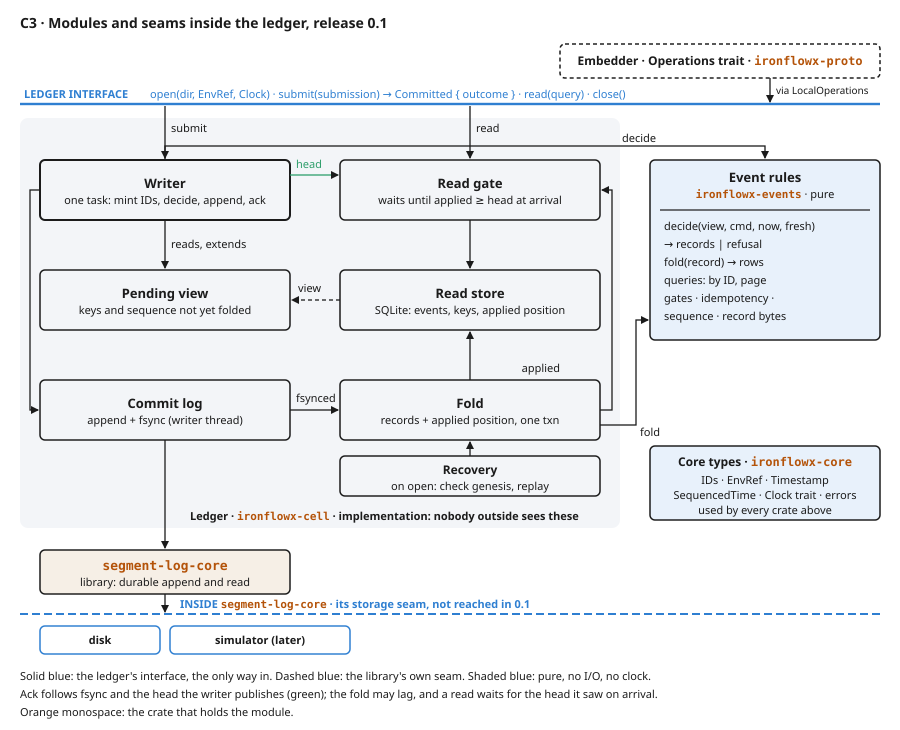

# 0.1 Ledger

**Durably commit one environment's events and read them back, in process.** The first release of Ironflow X: foundation crates only, no binary.

| | |
|---|---|
| **Status** | Ready for handoff. This folder is the source of truth; the copy in `sahina/ironflow` is frozen |
| **Ships** | Ledger · event rules · the `Operations` interface · core types |
| **Enables** | Emit and batch emit · idempotency keys · read an event by ID · list events by page · read your writes · crash safety |
| **Done when** | [`prd.md`](prd.md#done-when) |
| **Publishes** | `ironflowx-cell`, `ironflowx-events`, `ironflowx-proto`, `ironflowx-core` and the `ironflowx` facade at `0.1.0` |
| **Starts from** | `ironflowx` and `ironflowx-core` 0.0.1 on crates.io. `core` holds a hierarchical resource-name type; the first PR deletes it (LED-10) |
| **Next** | 0.2 Tenancy: credentials, the operation layer and the control plane, on top of this ledger |

The ledger's interface is the only way in; the writer, fold and read gate behind it are implementation.

| File | Read it for |
|---|---|
| [`prd.md`](prd.md) | What 0.1 delivers and why, what it leaves out, when it is done |
| [`architecture.md`](architecture.md) | C1, C2, C3, the flows, modules, seams, interfaces, event rules, errors, storage, decisions |
| [`invariants.md`](invariants.md) | The properties 0.1 must prove, and how; the crash test |
| [`behaviors/`](behaviors/README.md) | The executable scenarios, how they run, what is out of scope |
| [`specs/`](specs/) | One spec per build-order step, in order: core types and CI, event rules, the `Operations` interface, the ledger, the crash test |

## Glossary

The terms are in the repo's [`GLOSSARY.md`](../../../GLOSSARY.md). The types (`EnvRef`, `Timestamp`, `SequencedTime`) are in [`architecture.md`](architecture.md#modules).
