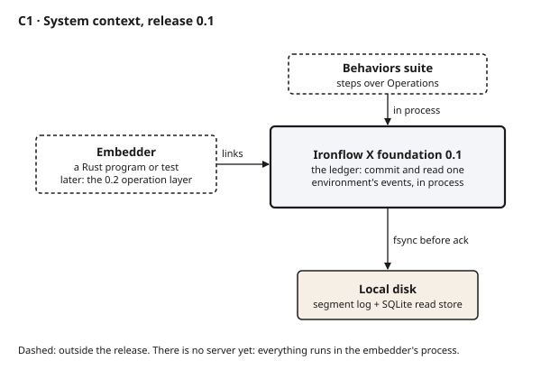
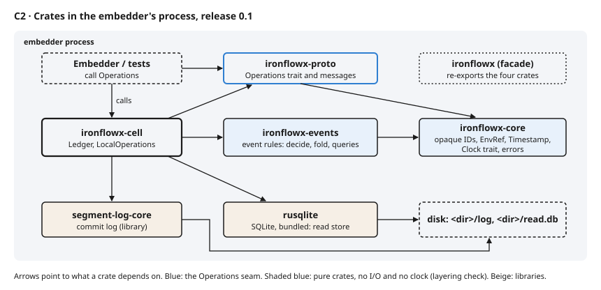
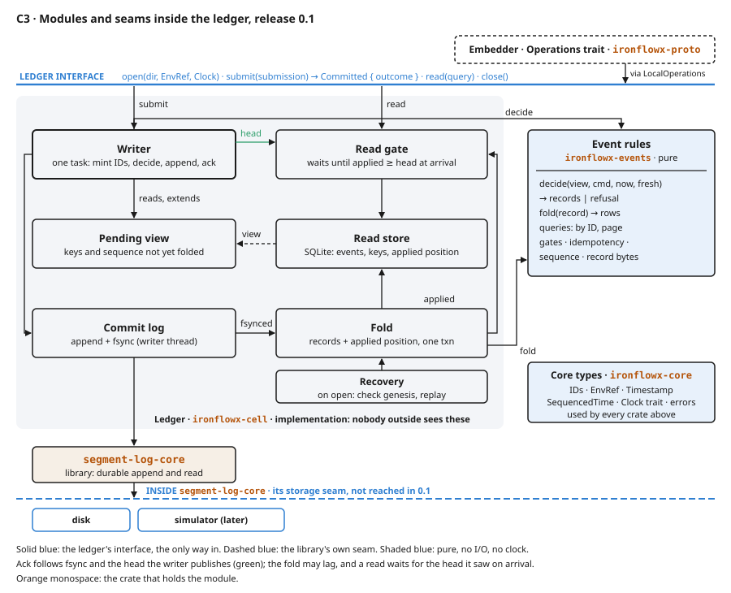
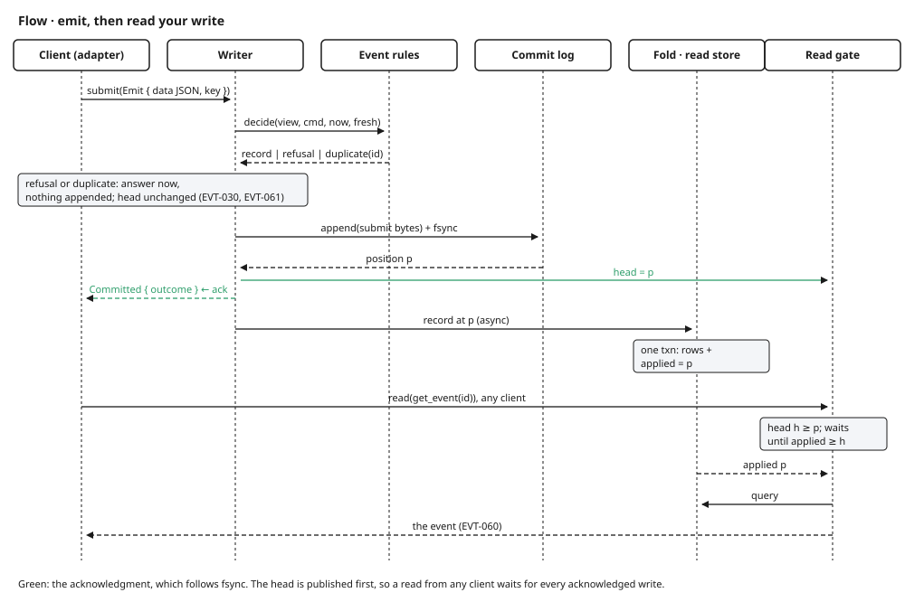
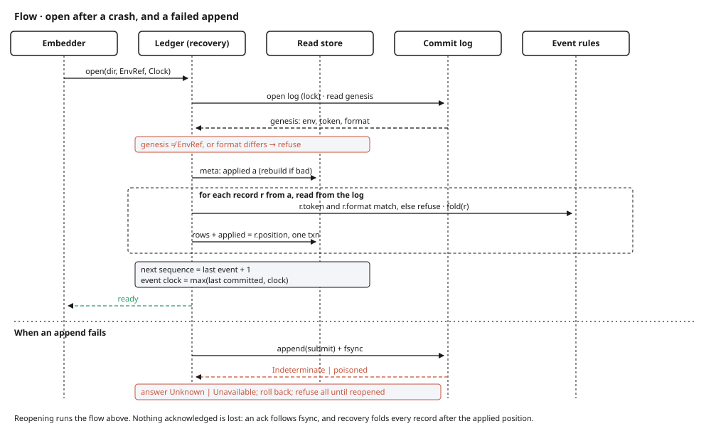

# 0.1 Ledger: architecture

One environment's commit path, as foundation crates linked into an embedder's process.

## C1: Context



The ledger is linked, not run: an embedder opens it in a directory.

## C2: Crates



Event rules and core are pure. Only the ledger touches disk, the clock and randomness.

## C3: Modules and seams



The ledger's interface is the only way in; everything inside it is implementation.

## Flows



How a write becomes visible to every reader: [Commit and read](#commit-and-read).



The rows behind it: [Open](#open).

## Modules

| Module | Does | Interface | Crate |
|---|---|---|---|
| Ledger | Commits one environment's changes; answers reads that see every acknowledged commit; mints event IDs and stamps event time | `open`, `submit`, `read`, `close`, `LocalOperations`, `HostClock`, `ManualClock` | `ironflowx-cell` |
| Event rules | Decides what an event is and when an emit is refused. Pure | `decide`, `fold`, queries | `ironflowx-events` |
| `Operations` interface | The operations a client calls, with their request and answer types. Hand-written Rust types; 0.3 maps a wire format onto them | `Operations` trait and messages | `ironflowx-proto` |
| Core types | Validated IDs, `EnvRef`, `Timestamp`, `SequencedTime`, the `Clock` trait, errors | Types | `ironflowx-core` |

`LocalOperations` implements `Operations` over one `Ledger`. It maps each request to a submission and each outcome to an answer and holds no rule: every check, default and limit is in event rules. Tests and embedders use the same adapter.

| Type | Is |
|---|---|
| `Timestamp` | A UTC instant in whole milliseconds. Private fields; `from_millis` and `as_millis` (`i64`) are the only conversions (D18) |
| `SequencedTime` | A reading of the event clock. Its one constructor is `#[doc(hidden)]`, and a lint allows it only in `ironflowx-cell` (D17); it compares with itself, never with `Timestamp` or `std::time` |
| `Clock` | A trait in core: `fn now(&self) -> Timestamp`. Core declares it and never calls it |
| `EnvRef` | `{ id: EnvironmentId, token: IncarnationToken }`. Text form `<uuid>.<32 hex digits>` via `Display` and `FromStr`, so an embedder can store it |

## Seams

| Seam | Adapters | In 0.1 |
|---|---|---|
| `Operations` | `LocalOperations` over one ledger · a remote client over the network | `LocalOperations`; the remote client arrives with the server in 0.3 |
| `Clock` | `HostClock` · `ManualClock`, which a test sets and steps, backwards too | Both, in `ironflowx-cell`. The behaviors and the crash test use `ManualClock` |
| Ledger, event rules | One adapter each | Module interfaces, not seams |

The segment log has a storage seam of its own, private to `segment-log-core`; 0.1 does not reach it.

## Interfaces

Shapes; names may change in the first PRs, behavior may not.

```rust
// ironflowx-proto: the 0.1 subset. No dyn use in 0.1; adapters are generic.
trait Operations: Send + Sync {
    fn emit(&self, cx: &Call, req: EmitRequest) -> impl Future<Output = Result<EmitResponse, OpError>> + Send;
    fn emit_batch(&self, cx: &Call, req: EmitBatchRequest) -> impl Future<Output = Result<EmitBatchResponse, OpError>> + Send;
    fn get_event(&self, cx: &Call, req: GetEventRequest) -> impl Future<Output = Result<Event, OpError>> + Send;
    fn list_events(&self, cx: &Call, req: ListEventsRequest) -> impl Future<Output = Result<EventPage, OpError>> + Send;
}
// EmitRequest      { name: String, data: Option<Vec<u8>> /* one JSON value (D22); None stores null */,
//                    metadata: Option<Vec<u8>> /* one JSON object */, version: Option<i64> /* None stores 1 */,
//                    idempotency_key: Option<String> /* None: no key */ }
// EmitResponse     { event_id: EventId, duplicate: bool }
// EmitBatchRequest { items: Vec<EmitRequest> }
// EmitBatchResponse{ items: Vec<Result<EmitResponse, OpError>> }  // one per input, in input order
// GetEventRequest  { event_id: String }                            // an ID that does not parse is NotFound
// Event            { event_id, name, data: Vec<u8> /* the bytes as sent */, metadata: Option<Vec<u8>>, version: i64,
//                    idempotency_key: Option<String>, time: Timestamp }
// ListEventsRequest{ limit: Option<NonZeroU32> /* None 20, above 200 clamps to 200 */, cursor: Option<String> }
// EventPage        { events: Vec<Event> /* newest first */, next: Option<String> /* None on the last page */ }
// Call             an opaque value with no fields in 0.1 (Call::anonymous()); 0.2 gives it the credential.
// OpError          { kind: ErrorKind, message: String }   // see Errors

// ironflowx-cell (tokio)
impl Ledger {
    async fn open(dir: &Path, env: EnvRef, clock: impl Clock) -> Result<Ledger, OpenError>;
    async fn submit(&self, sub: Submission) -> Result<Committed, SubmitError>;
    async fn read<Q: Query>(&self, q: Q) -> Result<Q::Answer, ReadError>;
    async fn close(self);   // drains in-flight submits and the fold, then releases the directory lock
}
fn new_env_ref() -> EnvRef;   // a fresh UUIDv7 ID and a 128-bit token from the OS random source
// Committed   { outcome: Vec<ItemOutcome> }   // one per item, in input order
// ItemOutcome New(EventId) | Duplicate(EventId) | Refused(Refusal)   // Refused only inside a batch
// SubmitError Refused(Refusal) | Unknown | Unavailable              // Refused: a single emit, or a whole batch

// ironflowx-events: pure. `fresh` yields one event ID per new event, minted by the writer.
fn decide<V: EventsView>(view: &V, sub: &Submission, now: SequencedTime,
          fresh: &mut impl Iterator<Item = EventId>) -> Result<Decision, Error<V::Error>>;
fn fold<T: EventTables>(tx: &mut T, record: &Record) -> Result<(), T::Error>;
// Error<E> Refused(Refusal) | Store(E)   // E: the view's own read error
```

## Event rules

`decide` runs in this order, and every step runs before the idempotency lookup (D5):

1. **Batch count:** more than 100 items refuses the whole batch.
2. **Item rules**, below, per item. A breach refuses the emit, or that batch item, as `Invalid`.
3. **Batch bytes:** the data and metadata of the items that passed step 2, as sent, total at most 4 MiB; else the whole batch is refused.
4. **Idempotency lookup**, in input order. A key seen earlier in the same batch counts (EVT-022).
5. **IDs:** one drawn from `fresh` per new event.

| Field | Rule | Scenarios |
|---|---|---|
| Name | 1–256 bytes of UTF-8 (bytes, not characters) | EVT-010, EVT-011, EVT-012 |
| Name | Segments split on `.`; none empty. No Unicode whitespace (`char::is_whitespace`), no control character (`char::is_control`) | EVT-011, EVT-012 |
| Name | Owned, so refused, in exact case: `ironflowx`, `ironflowx.…`, `$system`, `$system.…` | EVT-012, EVT-013 |
| Data | Absent stores `null`. Otherwise one JSON value of at most 524,288 bytes as sent, stored and returned as those bytes | EVT-003, EVT-004, EVT-017, EVT-039 |
| Data, metadata | Valid UTF-8. Nested at most 127 deep; no number outside `f64` range; no key repeated in one object at any depth, comparing keys after unescaping; no NUL in any key or string after unescaping; no unpaired surrogate escape | EVT-016, EVT-039 |
| Data | A top-level object key `$redacted`, whatever its value, is refused; nested ones are accepted | EVT-014, EVT-015 |
| Metadata | Absent, or a JSON object of at most 65,536 bytes as sent | EVT-016, EVT-038 |
| Version | Absent stores 1; otherwise 1 to 2,147,483,647 | EVT-002, EVT-008, EVT-009 |
| Idempotency key | Absent means no key; otherwise 1–256 bytes, no NUL. One key per environment, across names, for as long as its event exists | EVT-030–037 |
| Batch | An empty batch answers with no results | EVT-023 |

A list query, not `decide`, checks the cursor: a token that does not decode, or names another incarnation, is `Invalid` (EVT-045, EVT-055). A cursor encodes the incarnation token and the last event sequence returned, and stays valid across reopen. It is an encoding, not a signature: 0.1 does not detect a forged one.

## Errors

The kind is contract. Four messages are contract too: `event name is required`, `event data exceeds maximum size`, `batch size {n} exceeds maximum of 100` and `event not found`. Other messages are not.

| Kind | When | Retry |
|---|---|---|
| `Invalid` | A rule refused the request, or one batch item | No: the same request is refused the same way |
| `NotFound` | No event has that ID, or the ID does not parse | No |
| `Unknown` | The append's outcome is unknown; the ledger is now `Unavailable` | After reopen. With a key, the retry returns the original event if it landed. Without one it may store a second event |
| `Unavailable` | The ledger failed (append, fold or read store) and refuses every call until it is reopened. Reads waiting at the gate end with it | After reopen |

## Commit and read

1. The writer is one task and takes one submission at a time (D15). For each it reads the event clock and calls `decide` against the read store, drawing IDs from a UUIDv7 generator.
2. Nothing to append (all refused, or all duplicates): it answers at once.
3. Otherwise it appends one record holding every new event and waits for the log's fsync under `spawn_blocking`. Each new event takes the next event sequence, from 1, in input order.
4. It publishes the new committed head to the read gate, then acknowledges. Then it folds the record, before it takes the next submission, so the read store holds every earlier record when `decide` runs.
5. A read snapshots the committed head when it arrives and waits until the applied position reaches it. So it sees every write acknowledged before it arrived, whoever made it.

The committed head and the applied position are exclusive log offsets: one past the last record, as the log's watermark is.

## Open

`open` opens the log first, under its directory lock, then the read store.

| Directory state | Result |
|---|---|
| Empty or missing | Creates the log and appends the genesis record (format version, environment ID, incarnation token) at offset 0, then creates `read.db` and folds it; ready |
| Log, genesis matches the `EnvRef` and format | Replays every record from the read store's applied position; ready |
| Log, genesis differs in environment ID or token | `OpenError::WrongIncarnation` |
| Log, genesis differs in format version, or the log's own format is unsupported | `OpenError::Format` |
| `read.db` missing, without `meta`, unreadable, or `meta` disagrees with the genesis record | Deletes `read.db` and its `-wal` and `-shm` files, rebuilds from offset 0 |
| Applied position beyond the log's watermark | Rebuilds `read.db`, as above |
| A replayed record carries another token or format | `OpenError::Corrupt` |
| The log reports corruption, a gap or a foreign segment | `OpenError::Corrupt` |
| Another process or `Ledger` holds the directory | `OpenError::Locked`, from the log's directory lock, which dies with the process |
| Any other I/O failure | `OpenError::Io` |

The genesis record is the directory's identity; `read.db` is derived state and never trusted over it. The log binds every segment to one log ID, so a segment from another log does not open.

Dropping a `Ledger` without `close` stops the writer; in-flight submits end `Unknown` and the lock is released when the log handle drops.

## What is stored

| Where | Holds |
|---|---|
| `<dir>/log/` (segment log) | Offset 0: the genesis record. Then one record per submit that appends: format version, incarnation token, event-clock time, and for each new event its sequence, ID, name, version, key, metadata and data. Binary and length-prefixed; data and metadata are the bytes as sent |
| `<dir>/read.db` (SQLite) | `events` keyed by sequence, unique by ID · `idempotency` key → event ID · `meta`: applied position, environment ID, incarnation token, format version |

A record's worst case is 100 × (about 600 bytes of fixed fields and lengths) + 4 MiB of data and metadata, under 4.1 MiB.

## Depends on

| Crate | Version | Used | Relied on |
|---|---|---|---|
| `segment-log-core` | `=0.1.0` from crates.io (MIT) | `SegmentLog::open`, `append` → `Pending::wait`, `read(from, max)`, `watermark` | See below |
| `rusqlite` | Pinned in the first PR, `bundled` | Read store | One transaction per folded record |
| `serde_json` | Pinned in the first PR; the 127 depth limit is checked against it | Event rules | D12 |
| `uuid` | Pinned, `v7` | Event and environment IDs | |
| `getrandom` | Pinned | `new_env_ref` | OS random source |
| `tokio` | Pinned | The writer task, `spawn_blocking`, the read gate | |

How the ledger uses the log:

- **Options:** `group_byte_cap` 8 MiB (the library's maximum, above the 4.1 MiB worst case), `pending_byte_budget` at least that, `linger` 0, since the writer sends one record at a time.
- **Records:** one stream, `events`; the genesis record expects `ExpectedRevision::Empty`, each later one `At(last revision)`. No log key: the ledger keeps its own idempotency.
- **Errors:** `CommitError::Indeterminate` is `Unknown`. `CommitError::Poisoned` and `AppendError::Poisoned` are `Unavailable`. Every other append or commit error (`Full`, `TooLarge`, `Invalid`, `Sealed`, `WrongRevision`, `KeyConflict`, `PartialRetry`, `Exhausted`) cannot happen by construction; if one does, the ledger treats it as a fault: `Unavailable` until reopened.
- **A sealed log:** nothing in 0.1 seals one; only the log's operator repair tool does. The library opens it without an error and cannot say it is sealed until an append, so `open` succeeds, reads work, and the first emit is the fault above (D19).
- **Names:** the log's `Record`, `Position` and `Committed` types stay private to `ironflowx-cell`. This repo calls them the log record and the log offset; the ledger's own terms are in [`GLOSSARY.md`](../../../GLOSSARY.md).
- **Durability:** `wait` returns after the record's `sync_data`, which is a full flush on Linux and macOS. 0.1 claims crash durability on both. Power-loss durability is unclaimed until the simulator proves it.

## Decisions

| # | Decision | Why |
|---|---|---|
| D1 | `Operations` in 0.1 is `emit`, `emit_batch`, `get_event`, `list_events`, as hand-written Rust types. Data and metadata are bytes that must hold JSON (D22); optional fields are `Option` | Event rules own every data and range check, for every door: duplicate keys, lone surrogates and invalid UTF-8 exist only in the bytes as sent |
| D2 | Every `Operations` call takes a `Call`, opaque and empty in 0.1 | The trait does not change shape when 0.2 adds the credential |
| D3 | Read your writes through a committed head published before the acknowledgment ([Commit and read](#commit-and-read)) | One fsync on the acknowledgment path, and read your writes holds across clients |
| D4 | The append is the segment log's blocking call, run under `spawn_blocking` on the writer's task | The writer is the log's only writer, so it knows when a commit lands |
| D5 | Every check, including the version range, runs before the idempotency lookup | The same request is refused the same way, first time or repeat |
| D6 | Events list newest first by event sequence | Commit order is total, so two events never tie |
| D7 | The event clock never goes back: each record's time is the later of the clock and the last committed time | Restarts and clock steps keep event time ordered |
| D8 | A ledger refuses a directory whose format version or incarnation differs | Formats change freely before 1.0; a loud refusal beats a silent misread |
| D9 | A batch is one record: items are checked one by one, new items commit together, and the answer has one result per input in order | Partial validation, atomic commit |
| D10 | The writer mints event IDs (UUIDv7) and `decide` draws them only for new events | Event rules stay pure; an ID exists before the record is written |
| D11 | An unknown append outcome closes the ledger until reopen; there is no append retry | After reopen the log says whether the record landed |
| D12 | Event rules parse the bytes with `serde_json` (`from_slice`, which refuses invalid UTF-8 in the same pass) and a visitor that deserializes every key and string (never `IgnoredAny`), erroring on a repeated key, a NUL or a number out of range. `serde_json` hands keys over unescaped and refuses unpaired surrogate escapes, but only for values it decodes | No second JSON parser |
| D13 | Environment and event IDs are UUIDv7 | One opaque ID format for every resource |
| D14 | The genesis record, not `read.db`, holds the directory's identity | A swapped or rebuilt read store cannot pass for another environment |
| D15 | The writer is one serial task: decide, append, fsync, publish, acknowledge, fold, then the next submission. 0.1 sets no performance target | `decide` reads the read store, with no overlay of unfolded records to keep right |
| D16 | `segment-log-core` comes from crates.io at exactly `0.1.0` | A published crate cannot depend on a git revision |
| D17 | A lint, not the type system, keeps `SequencedTime`'s constructor inside `ironflowx-cell`. One helper in `crates/ironflowx-events/tests/rules.rs` is exempt, by an `#[expect]` on that function alone: it stands in for the ledger to call `decide` | The type is in core so that pure event rules can take one, and Rust cannot open a constructor to one downstream crate only |
| D18 | `Timestamp` has one integer encoding, `i64` milliseconds. The SQLite impl is in `ironflowx-cell` on a private wrapper, and the log record uses the same pair | Core stays free of `rusqlite` (LED-15), and the log stores event time too |
| D19 | `open` does not refuse a sealed log | The library reports a seal only on append. A refusal at open waits for it to expose one |
| D20 | The behaviors run under the `cucumber` crate, in an unpublished workspace crate | The feature files are the spec, run from this folder |
| D21 | The public-API checks compare `cargo-public-api` output with a committed snapshot, on a pinned nightly toolchain in one CI job | The tool needs rustdoc JSON, which stable does not emit. Every other job stays on the pinned stable |
| D22 | Event data and metadata are bytes by type and JSON by rule: `Vec<u8>` in `Operations` and event rules, which still require one JSON value for data and one JSON object for metadata under every rule in the table, and refuse invalid UTF-8. When a non-JSON payload is needed, the event gains an optional first-class content type: absent means JSON, non-JSON data is stored and returned as sent, and every feature that reads inside data skips it. 0.1 builds nothing for the content type | The engine reads inside data (`$redacted` now; filters, keys, schemas and redaction later), so data cannot be opaque. JSON-only can gain a content type later without touching a stored event; the reverse cannot be undone. Bytes by type puts the UTF-8 check in event rules, for every door |
